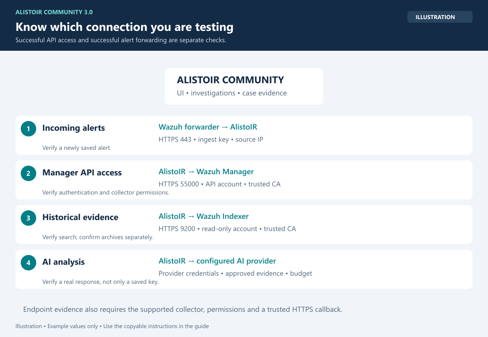
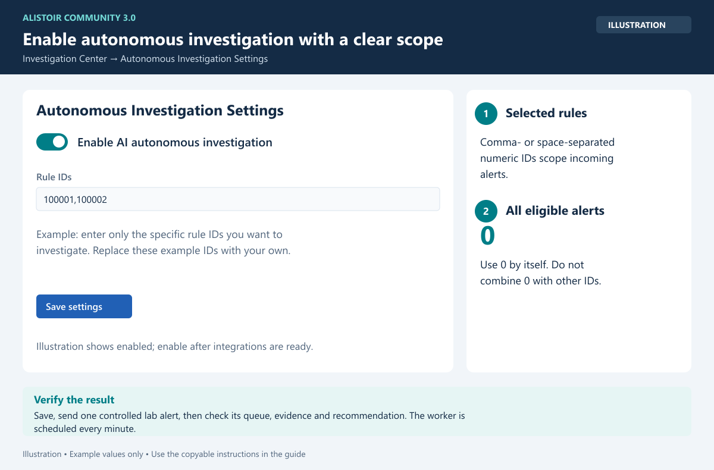

# Configuration

## Administrator and accounts

Use the generated administrator account, change its password and configure 2FA where available. Use individual analyst accounts for auditability. Community supports 5 active accounts including administrators. Disable an existing account to free a slot; inactive accounts do not count. The Add User button is disabled at the active limit and server-side checks also enforce it.

## Wazuh



*Illustration: verify each direction independently. API authentication, incoming alerts, evidence search and AI output are different readiness checks.*

Open **Wazuh Setup**, or `/integrations/wazuh_setup`. Follow [the Wazuh guide](WAZUH_SETUP.md). Configure exactly one manager, its API and optional Indexer settings, trusted public CA certificates and the actual Wazuh source IP seen by AlistoIR. Credentials are stored through the application configuration interface; do not embed them in public scripts.

Manager/Indexer access and incoming alert ingestion are separate directions. A successful API authentication test does not prove that the Wazuh forwarder is sending alerts.

## AI provider

Open **Integration Settings** (`/integrations/configuration`). Select a supported provider/model and supply your own credentials or supported local endpoint. Enable only the provider you intend to use and validate it with approved lab evidence.

Cloud providers may receive SOC evidence during AI workflows and may charge for usage. No AI subscription or credits are included. A configured key does not prove provider balance, permissions or availability. A provider quota/balance error must be resolved before verdict completion can be expected.

## Autonomous investigation



*Illustration: enable only after integrations are ready. Use your own numeric rule IDs, or `0` by itself for all eligible incoming alerts.*

Open `/investigations/settings` as System Administrator:

1. Configure and validate Wazuh/Indexer/endpoint integrations first.
2. Enable automatic investigation.
3. Set Rule IDs:
   - `0` by itself: all eligible incoming alerts.
   - Specific numeric IDs separated by commas/spaces: selected rules only.
   - Do not combine `0` with other IDs.
4. Save and send one controlled lab alert before enabling a broad scope.

Existing eligible alerts can be started from Investigation Center using their **AlistoIR Alert ID**, not the Wazuh Rule ID. Disabling the setting pauses automatic work; existing evidence remains available. Operational budgets, deadlines and approval checks still apply.

The investigation worker is scheduled every minute. Queue time depends on load, collection latency and configured budgets; do not assume immediate execution.

## Evidence readiness

Enable archives/search permissions only if required and storage/retention have been planned. The Wazuh wizard does not enable archives or change agent logging policies. Endpoint collection also needs the relevant Wazuh response/collector configuration and trusted HTTPS callbacks. Verify actual returned evidence before relying on its coverage.

## Playbooks and IOCs

- Maximum **5 active playbooks**. Inactive drafts do not count. Pause one to free a slot. Add/Activate controls are disabled when full; server/database checks enforce the cap. Default Community templates seed as inactive drafts.
- Maximum **3,000 active unique IOC feed indicators**. Unexpired or no-expiry entries count; expired entries do not. The feed library currently has no separate disabled/archived IOC state. Disabling a feed source does not expire its existing indicators.
- Duplicates share a quota slot. Same-scope imports update existing entries. Private/global records are not merged across visibility boundaries.
- At capacity, new active rows are skipped/blocked with a message. Existing matching, external reputation queries and investigation evidence remain available.

## Private CTI destinations and download safety

Public feed requests block loopback, link-local, metadata and reserved addresses. Redirects are blocked: use the final trusted HTTPS URL. DNS results are validated and pinned during the request.

An administrator may explicitly allow private MISP/OpenCTI origins in the protected server environment, for example:

```text
IOC_ALLOWED_PRIVATE_ORIGINS=https://misp.company.example:8443
IOC_API_CA_BUNDLE=/absolute/path/to/trusted-ca-bundle.pem
IOC_FEED_MAX_BYTES=5242880
```

Use your actual approved origin/certificate path, not this example. Private-origin exceptions do not permit loopback/link-local/metadata targets. Stored provider credentials must remain on the configured integration origin. TLS verification stays enabled. Default response limit is 5 MiB decoded, bounded 1–20 MiB.

## Official build integrity

Protected policy/enforcement files are signed. Editing them causes protected writes to fail with **Integrity validation failed**. Restore matched official files and manifest; do not disable the verifier to troubleshoot. Runtime settings such as supported integration configuration belong in the UI/private environment, not edits to protected PHP files.

A root/source owner can remove checks. This is tamper detection, not unbreakable licensing or a substitute for secure server administration.

## Outbound AI privacy

Version 3.0.3 applies a mandatory privacy boundary to all AIService providers, including configured local endpoints. See [AI_PRIVACY.md](AI_PRIVACY.md) for withheld fields, aliases, evidence gaps and limitations. Provider authentication headers remain necessary; threat-intelligence API lookups are separate.
