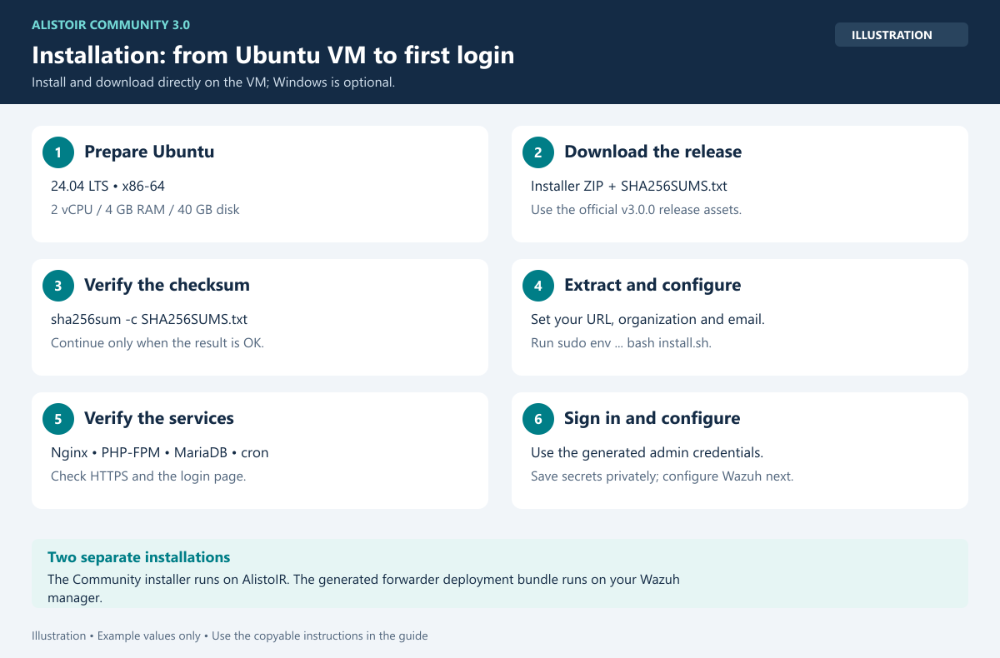
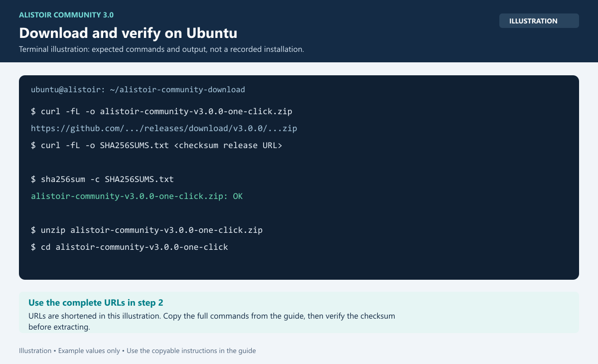

# Installation — AlistoIR Community 3.0.3



*Illustration: the installation sequence. Run the copyable commands below directly on your Ubuntu VM.*

## 1. Prepare a new VM

Use Ubuntu Server 24.04 LTS x86-64 with at least 2 vCPUs, 4 GB RAM, 40 GB disk, a stable IP/hostname and Internet access. The installer refuses an existing app directory/environment or a non-empty target database.

Network access:

| Direction | Purpose |
|---|---|
| Administrator -> AlistoIR TCP 22 | SSH installation/maintenance; restrict to management networks |
| Browser/Wazuh/endpoints -> AlistoIR TCP 443 | UI, ingestion and supported callbacks |
| AlistoIR -> Wazuh configured API port (typically 55000) | Manager/agent API |
| AlistoIR -> configured Indexer port (typically 9200) | Historical evidence searches |
| AlistoIR -> configured AI/TI destinations | Explicitly enabled integrations |

Port 80 provides an HTTPS redirect when reachable. Preserve normal Wazuh agent connectivity separately. Do not expose management ports broadly just to complete setup.

## 2. Download directly on the Ubuntu VM

Run these commands in the VM console or an SSH session on the VM. No Windows computer or GitHub login is required.

```bash
sudo apt update
sudo apt install -y curl unzip ca-certificates
umask 077
mkdir -p ~/alistoir-community-download
cd ~/alistoir-community-download
curl --fail --location --show-error --output alistoir-community-v3.0.3-one-click.zip \
  https://github.com/alistoirph/AlistoIR-Community/releases/download/v3.0.3/alistoir-community-v3.0.3-one-click.zip
curl --fail --location --show-error --output SHA256SUMS.txt \
  https://github.com/alistoirph/AlistoIR-Community/releases/download/v3.0.3/SHA256SUMS.txt
```

Both downloads must finish successfully before continuing. These URLs download the installer asset and its checksum from [the official release](https://github.com/alistoirph/AlistoIR-Community/releases/tag/v3.0.3). GitHub's automatically generated Source code archives contain documentation only.

## 3. Verify SHA-256 on the VM



*Illustration: expected checksum result. URLs in the image are shortened; use the full download commands above.*

From the same directory:

```bash
sha256sum -c SHA256SUMS.txt
```

Expect `alistoir-community-v3.0.3-one-click.zip: OK`. Stop if verification fails and re-download from the official release.

## 4. Extract on the VM

Continue from `~/alistoir-community-download`:

```bash
mkdir -p ~/alistoir-community-install
unzip alistoir-community-v3.0.3-one-click.zip -d ~/alistoir-community-install
cd ~/alistoir-community-install/alistoir-community-v3.0.3-one-click
```

The ZIP filename, internal directory and core application version identify `3.0.3`.

<details>
<summary>Optional: download on Windows and copy to the VM</summary>

If direct downloads from the VM are unavailable, download the installer ZIP and `SHA256SUMS.txt` from the official release on Windows. Replace `ubuntu` and `ALISTOIR_IP` with your VM account and address:

```powershell
scp .\alistoir-community-v3.0.3-one-click.zip .\SHA256SUMS.txt ubuntu@ALISTOIR_IP:/home/ubuntu/
ssh ubuntu@ALISTOIR_IP
```

On the VM, install the tools, verify the copied archive and extract it:

```bash
sudo apt update
sudo apt install -y unzip ca-certificates
cd ~
sha256sum -c SHA256SUMS.txt
```

Continue only after the checksum reports `OK`:

```bash
umask 077
mkdir -p ~/alistoir-community-install
unzip alistoir-community-v3.0.3-one-click.zip -d ~/alistoir-community-install
cd ~/alistoir-community-install/alistoir-community-v3.0.3-one-click
```

</details>

## 5. Install

Replace `192.0.2.10`, organization and email below with your real values. Use the final IP/hostname you will access; it is used for HTTPS and callback URLs.

```bash
sudo env \
  APP_BASE_URL="https://192.0.2.10" \
  APP_TIMEZONE="Asia/Manila" \
  PROFESSIONAL_ADMIN_TIMEZONE="Asia/Manila" \
  PROFESSIONAL_ORGANIZATION_NAME="Example SOC" \
  PROFESSIONAL_ADMIN_NAME="Administrator" \
  PROFESSIONAL_ADMIN_EMAIL="admin@example.com" \
  bash install.sh
```

`PROFESSIONAL_*` variable names and internal `alistoir-professional` paths are compatibility names. The installed edition is **AlistoIR Community** and requires no paid license.

The installer configures Nginx, PHP, MariaDB, HTTPS, schema/migrations, background jobs, security services and the first administrator. Let it finish. If package downloads are slow, monitor them rather than repeatedly restarting the installer. If it fails after creating the app/environment, do not delete data or force an overwrite: see troubleshooting.

The final console output contains a generated administrator password, ingest key and enrollment token. Save them privately in a password manager. Do not post the output to GitHub or include it in screenshots.

## 6. Verify services and HTTPS

```bash
sudo systemctl is-active nginx php8.3-fpm mariadb cron
sudo nginx -t
sudo curl --cacert /etc/nginx/ssl/alistoir-professional/root-ca.pem \
  -s -o /dev/null -w 'Login HTTP %{http_code}\n' \
  https://192.0.2.10/auth/login
```

Replace the example IP. Expect active services, valid Nginx config and HTTP 200 for the login page.

Open `https://YOUR_ALISTOIR_HOST`, sign in with the administrator email/generated password, and change the password when prompted.

## 7. Trust HTTPS appropriately

The default installer creates a local CA. Its public certificate is:

```text
/etc/nginx/ssl/alistoir-professional/root-ca.pem
```

Verify its SHA-256 file hash over your trusted SSH connection before importing a copied certificate:

```bash
sudo sha256sum /etc/nginx/ssl/alistoir-professional/root-ca.pem
```

Use `Get-FileHash -Algorithm SHA256` to compare the same copied file on Windows. Import only the public certificate. Never copy or share `root-ca.key` or the server private key.

For browser access, a trusted CA in the relevant user's store may suffice. Windows service callbacks may need the CA in **Local Computer / Trusted Root Certification Authorities**, which requires administrator approval and affects machine services. The Wazuh forwarder bundle uses its own CA file; it does not install system-wide trust automatically.

## 8. Continue with configuration

Follow [CONFIGURATION.md](CONFIGURATION.md) and [WAZUH_SETUP.md](WAZUH_SETUP.md). Autonomous processing starts disabled. An installed service alone does not prove live evidence collection or AI availability.
