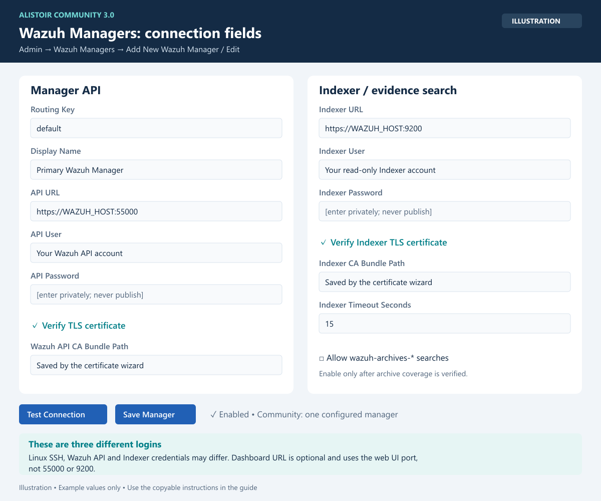
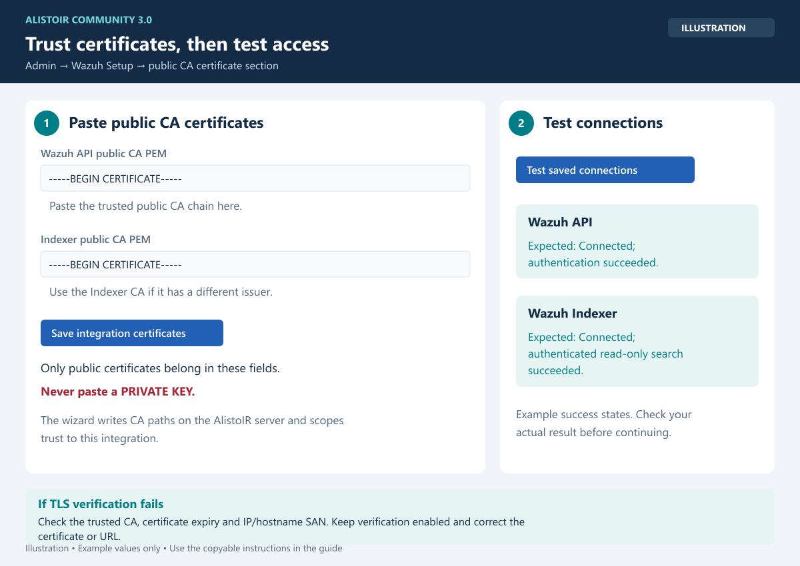
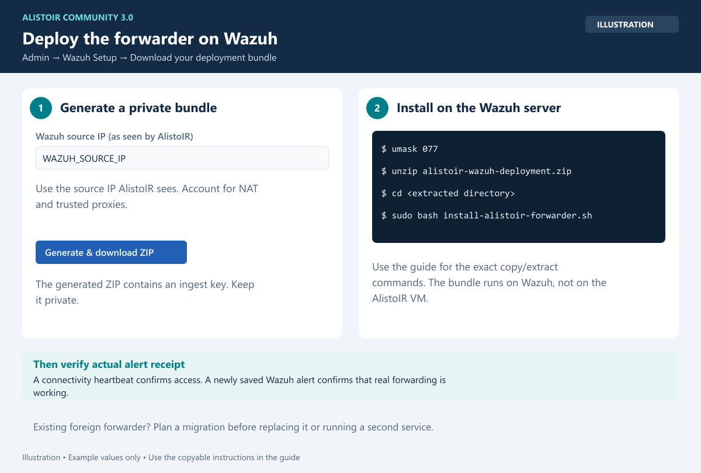

# Wazuh setup: generated files and one-command installation

There are **two different ZIPs**:

- The Community release installer installs the AlistoIR server.
- The wizard's **`alistoir-wazuh-deployment.zip`** installs forwarding on your Wazuh manager and contains an ingest credential.

## 1. Configure the connection

As AlistoIR System Administrator, open **Wazuh Setup** (`Admin -> Wazuh Setup`). Click **Configure Wazuh Manager & Indexer**, enter the addresses, credentials and manager key, then save and enable the connection. Community supports one configured manager, including any environment-configured connection. Editing the existing record is the normal way to change it.

Use read-only API/Indexer permissions where practical for collection. Keep TLS verification enabled. Manager API authentication and Indexer evidence search permissions are tested separately.

### Wazuh Managers: field-by-field configuration



*Illustration: example values, not a live screenshot. Match the API and Indexer sections to the fields below; supply your own private credentials.*

Open `https://YOUR_ALISTOIR_HOST/integrations/wazuh_managers` as a System Administrator. Click **Add New Wazuh Manager**, or **Edit** if a manager already exists. Community supports one configured manager; edit that record rather than adding another.

The following is an example for an all-in-one Wazuh server. Replace `WAZUH_HOST` with its reachable IP or hostname. Manager, Dashboard and Indexer can also run on different hosts.

| Field | Value / purpose |
|---|---|
| Routing Key | `default` for a new single-manager setup. Use the same key in the generated forwarder deployment. Preserve an existing key already used by alert ingestion. |
| Display Name | A descriptive label, for example `Primary Wazuh Manager`. |
| API URL | `https://WAZUH_HOST:55000` — Manager REST API base URL. Do not append an authentication or agents path. |
| Dashboard URL | Optional: the actual browser URL of your Wazuh Dashboard, for example `https://WAZUH_HOST`. Use its configured HTTPS port if different. This is a UI shortcut, not the API or Indexer URL. |
| API User | A Wazuh **API** user with permissions for the collection operations you enable. This is not the Linux SSH username or necessarily the Dashboard login. |
| API Password | That API user's actual password. Leave blank when editing to retain the stored password. |
| Verify TLS certificate | Enabled. Trust the public CA that issued the Manager API certificate. The URL IP/hostname must match the certificate SAN. |
| Wazuh API CA Bundle Path | Absolute path **on the AlistoIR VM** to a readable public PEM CA bundle. The Setup Wizard can save the certificate and populate this field; do not enter a path that exists only on Wazuh or on your PC. Leave empty only if the server certificate is already trusted by the system CA store. |
| Indexer URL | `https://WAZUH_HOST:9200` — Wazuh Indexer/OpenSearch base URL, not the Dashboard URL. Required for historical log evidence searches. |
| Indexer User | An **Indexer** account with read/search permissions on the Wazuh indices used by investigations. It is separate from the Manager API account. |
| Indexer Password | That Indexer account's actual password. Leave blank when editing to retain the stored password. |
| Verify Indexer TLS certificate | Enabled. Trust the Indexer public CA and use a matching certificate IP/hostname. |
| Indexer CA Bundle Path | Absolute path on AlistoIR to the Indexer's public PEM CA bundle, or use the Setup Wizard to save it. API and Indexer may need different CA bundles. |
| Indexer Timeout Seconds | Start with `15`; the form accepts `3`–`120`. Increase only if legitimate queries need it; a higher timeout does not fix routing or credentials. |
| Allow wazuh-archives-* searches | Enable only when raw archives are enabled, indexed, retained and readable by the configured account. This checkbox does not enable Wazuh archives or create historical data. |
| Enabled | Checked for the connection you want AlistoIR to use. |

**Credentials:** use credentials supplied by your Wazuh administrator. Do not assume the SSH, Dashboard, API and Indexer passwords are interchangeable. For a Wazuh installation generated by the official installer, the administrator may have an installation-generated credentials inventory; inspect it privately on that server, never upload it or paste it into GitHub. Do not change a shared service account password merely to connect AlistoIR.

Click **Test Connection** to check the Manager API, then **Save Manager**. Return to **Wazuh Setup** and run **Test saved connections** to verify both API authentication and an authenticated Indexer search. Both checks should succeed with TLS verification enabled. Saving the form alone does not prove connectivity.

**What this does not configure:** saving a manager does not install the forwarder, replay old alerts, enable autonomous investigation, enable raw archives, or deploy endpoint collection scripts. Continue with the certificate and deployment steps below, then configure autonomous processing separately in [CONFIGURATION.md](CONFIGURATION.md).

## 2. Paste public CA certificates if needed



*Illustration: save trusted public CA certificates, then test both connections. The green results show what success should look like; check your actual result.*

Open the wizard's self-signed certificate section. Paste the Manager API public CA PEM and/or Indexer public CA PEM, then save. Do not paste private keys. Trust applies to this integration only. Confirm the certificate source/fingerprint through a trusted administrative channel before importing it.

## 3. Test the saved connections

Click **Test saved connections**. The Indexer check uses a size-zero match-none query and does not retrieve event content. If it fails, check routing, ports, TLS trust, credentials and permissions. It does not prove raw archive coverage or endpoint readiness.

## 4. Generate the deployment ZIP



*Illustration: generate the bundle in AlistoIR, then copy and install it on the Wazuh manager. The generated ZIP contains a secret ingest key.*

Enter the Wazuh server's source IP as AlistoIR sees it. Account for NAT or a trusted reverse proxy. The wizard adds this IP to the existing ingest allowlist and generates a new manager-bound ingest key. It does not overwrite existing keys automatically.

The ZIP includes:

- `wazuh_forwarder_standalone.py`
- `alistoir-wazuh-forwarder.service`
- `wazuh_forwarder.env`
- `install-alistoir-forwarder.sh`
- `check-forwarder.py`
- The public AlistoIR CA when available and a README

Manager API and Indexer passwords are not included. Keep this generated ZIP private; never attach it to a GitHub issue.

## 5. Copy to Wazuh and install

Use your actual administrator account and Wazuh address:

```powershell
scp .\alistoir-wazuh-deployment.zip wazuhadmin@WAZUH_IP:/home/wazuhadmin/
ssh wazuhadmin@WAZUH_IP
```

On the Wazuh manager:

```bash
umask 077
mkdir -p ~/alistoir-wazuh-setup
unzip ~/alistoir-wazuh-deployment.zip -d ~/alistoir-wazuh-setup
cd ~/alistoir-wazuh-setup
sudo bash install-alistoir-forwarder.sh
```

Requires Linux/systemd, Python 3.9+, standard SSL/SQLite modules, sudo, and readable `/var/ossec/logs/alerts/alerts.json`. No third-party Python packages are required by the forwarder.

Optional preflight without changing forwarding configuration:

```bash
sudo bash install-alistoir-forwarder.sh --check-only
```

The installer validates TLS, the ingest credential, source IP and manager binding before changing files. It backs up its own configuration, applies restrictive secret permissions, registers the service and checks startup. Managed reruns preserve cursor state; a failed restart restores the previous files and activation state.

A different existing forwarder is deliberately not overwritten. Plan and perform an explicit migration so two services do not forward the same stream. Do not delete the old cursor or run both forwarders to bypass this check.

Fresh installations start at the end of `alerts.json` to avoid unexpectedly replaying historical alerts. They forward all rule levels by default. Original manager identity is retained in `manager.original_name` when routing through the configured manager key.

## 6. Verify the service and actual alerts

```bash
sudo systemctl status alistoir-wazuh-forwarder --no-pager
sudo journalctl -u alistoir-wazuh-forwarder -n 30 --no-pager
```

Review logs locally and redact them before sharing. Return to Wazuh Setup and refresh. Connectivity heartbeat is authenticated and does **not** create a SOC alert. Generate approved benign activity in your lab and verify that a real Wazuh alert appears in AlistoIR.

Check each result separately:

| Check | Meaning |
|---|---|
| Connectivity check | TLS/key/source-IP/manager binding accepted |
| New saved alert | Actual alert forwarding verified |
| API/Indexer tests | Authenticated access/search path verified |
| Endpoint callback | Supported collector returned a result; review evidence coverage |
| AI configured | Credentials/configuration present; live output still needs validation |

No synthetic alert, archive enablement, endpoint-response policy change or AI enablement is performed automatically by this installer.

You can revoke a generated bundle key from Wazuh Setup. This stops that bundle's forwarding; confirm the intended replacement is ready first. API/Indexer credentials and previously deployed keys are not automatically rotated.
