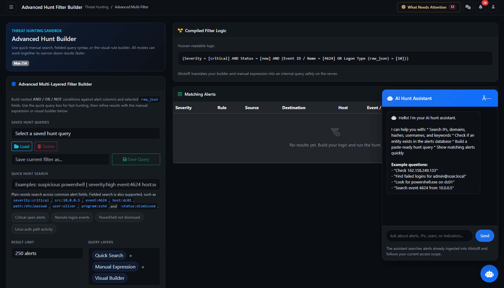

# Advanced Hunt — multi-filter analyst guide



Page: `/hunt/multi-filter`. Applies to AlistoIR Community 3.0.3. Availability depends on your role and deployment access settings.

Advanced Hunt combines conditions to search **alerts already stored in AlistoIR**. Use it when one indicator is insufficient: for example, successful remote logons from a particular source, or high-severity alerts involving a specific program and account.

It does not collect new endpoint evidence, search every Wazuh Indexer event, or automatically confirm an incident. Existing AI/risk badges remain stored assessments. For simpler indicator hunting, see [Threat Hunting](THREAT_HUNTING.md).

## 1. How to use it: first search

1. Open **Threat Hunting**, then **Advanced Multi-Filter**.
2. For a precise first search, leave **Quick Search** blank and enter this in **Manual Expression Query**:

   ```text
   event_id = 4624 AND logon_type = 10
   ```

3. Select a **Date Range**, such as Last 7 days, and a **Result Limit**, such as 250.
4. Select **Execute Manual Expression**.
5. Read **Compiled Filter Logic** to confirm the intended conditions.
6. Review **Matching Alerts** and use the eye/View action to inspect original evidence.
7. Refine the query, save it for reuse, or export the bounded results.

The example identifies stored Windows successful-logon events with logon type 10, where the expected fields exist. It does not prove an unauthorized login. Check account, host, source, time, normal activity and supporting evidence before reaching a verdict.

## 2. How the search layers combine

| Input | Actual behavior |
|---|---|
| Quick Search | Adds keyword/fielded conditions to the search. |
| Manual Expression Query | When non-empty, is parsed into the builder logic and takes priority over the submitted visual builder. |
| Visual builder | Supplies the grouped conditions when Manual Expression is empty. |
| Date Range | Adds a received/created-time restriction to the effective query. |
| Result Limit | Caps returned rows; it does not broaden evidence collection. |

**Quick Search AND effective manual/builder logic AND date conditions** determine the main search. The three “Query Layers” pills do not mean manual and visual rules always run independently together.

When Quick Search is non-empty and the builder is still its untouched default, the application can omit that default builder so the quick query works on its own. Once you edit the builder, its conditions can narrow the quick search. Always inspect the compiled human-readable logic.

The initial builder is an example: **Severity = critical AND Status = new AND (Event ID = 4624 OR Logon Type = 10)**. Notice the OR inside the group. It is not equivalent to requiring both event ID and logon type.

## 3. Quick Search

Enter a keyword or combine supported `field:value` tokens. Separate tokens combine with **AND**. A leading minus negates a token. This is a lightweight search syntax, not a full SQL, Lucene or Boolean-expression language.

```text
severity:high event:4624 host:training-host -status:dismissed
```

| Prefixes | Searched context |
|---|---|
| `rule`, `rule_id` | Description or rule identifier respectively. |
| `severity`, `status` | Exact stored severity/status value. |
| `src`, `source`, `dest`, `destination` | Normalized source/destination address. |
| `host`, `hostname`, `agent`, `agent_id` | Hostname, raw agent name or agent identifier. |
| `event`, `event_id`, `logon`, `logon_type` | Exact extracted event identifier/name or Windows logon type. |
| `path`, `file` | Supported extracted event path. |
| `user`, `srcuser`, `dstuser` | General extracted observed-user expression; these quick prefixes do not isolate separate source/destination user fields. |
| `program`, `pam`, `audit_key`, `syscall` | Supported program, PAM service, audit key or syscall. |
| `hash` | First available supported Syscheck MD5-after/SHA256-after value; not a general artifact-library search. |
| `json`, `raw` | Stored serialized raw payload text. |

Other recognized prefixes generally use partial matching. Bare keywords search multiple alert fields and raw JSON. An unsupported prefix can become a literal general keyword rather than an error; check spelling and compiled logic. The summary may say “contains” even for prefixes that actually use equality.

Use Manual Expression for grouped OR conditions, exact IP comparisons and values containing spaces. Quick Search is not an exact-IP/CIDR engine. SQL LIKE wildcards such as `%` and `_` can affect partial matches; they are not regular expressions.

Quick example chips populate the text box; run the hunt to search. A chip's title is a shortcut description, not a verdict or a complete incident definition.

## 4. Build conditions visually

1. Clear **Manual Expression Query** so it does not override visual edits.
2. Choose **AND** when every child condition must hold, or **OR** when any child can hold.
3. Select **+ Rule**, then choose a field, an available operator and a value.
4. Select **+ Group** to create a nested set of conditions.
5. Use the group's negation control to apply **NOT** to the whole group when appropriate.
6. Remove unwanted rules/groups with their delete controls. Each group must retain at least one rule.
7. Check Quick Search and date restrictions, then select **Run Advanced Hunt**.

For example, create a root AND group containing Status != dismissed, IOC Confidence >= 80, and a nested OR group containing Severity = critical and Severity = high.

AND/OR groups operate on fields of a matching alert row. They do not express a sequence across multiple alerts, a frequency threshold or proof that two events share an attacker.

### Available fields

| Category | Fields |
|---|---|
| Stored alert context | Rule ID, Severity, Status, Source IP, Destination IP, Hostname, Agent ID, Created At. |
| Stored intelligence context | IOC Matched, IOC Confidence. |
| Event/agent JSON | Event ID / Name, Logon Type, Source IP (raw_json), Destination IP (raw_json), Agent Name (raw_json). |
| Linux/file/process context | Event Path, Observed User, Source User, Destination User, Program Name, PAM Service, Audit Key, Audit Syscall, Audit AUID. |
| File integrity | Syscheck MD5 After, Syscheck SHA256 After, Syscheck Uname After. |
| Other payload searches | Rule Group (raw_json array), Raw JSON. |

Extraction supports specific payload paths, not every possible vendor schema. Event ID / Name can represent a Windows event ID or a Linux Syscheck/audit/osquery value. Coalesced fields use the first supported non-empty value; they do not merge every possible value. Normalized IP fields can differ from the specific raw-JSON IP paths.

Observed User is event context, not the assigned SOC analyst. Syscheck Uname After is file ownership context, not proof of which user performed a change. Missing fields can reflect missing collection or an unsupported layout.

### Operators and values

| Operator | Usage |
|---|---|
| `=`, `!=` | Compare a stored value. Text comparison case behavior depends on database collation. |
| contains / does not contain | Partial text matching. |
| starts with / ends with | Prefix/suffix matching. |
| in list / not in list | Comma-separated values, such as `high,critical`; not a quoted CSV import format. |
| `>`, `>=`, `<`, `<=` | Available for supported numeric fields such as IOC Confidence. |
| between | Two bounds, inclusive; use ascending values. |
| is empty / is not empty | NULL/empty-string checks. |
| array contains / array does not contain | Intended for a Rule Group array element; verify against known events before relying on exclusions. |

Only operators available for the chosen field are supported. Use `1`/`0` for IOC Matched and a numeric confidence threshold. Stored missing IOC values are treated as zero here, so zero is not proof that enrichment completed.

Negative comparisons do not generally include NULL values automatically. To include missing source addresses, explicitly combine `src_ip IS NULL` with the other condition using OR. An empty array and an absent array are also different states.

Current Rule Group array matching has an encoding limitation that can miss ordinary string members. If a known group is not found, inspect the payload and use a carefully scoped Raw JSON contains search as a text-only fallback. Do not interpret array non-matches as absence of the technique/group.

## 5. Manual Expression Query

Use supported field identifiers, parentheses, AND, OR and NOT. NOT binds before AND, which binds before OR; parentheses make intent clearer. This is a restricted expression language, not arbitrary SQL or shell execution.

```text
(severity = high OR severity = critical) AND status != dismissed AND ioc_confidence >= 80
```

```text
event_id = (4624|4625) AND status = (new|"in progress")
```

```text
event_path CONTAINS "/etc" AND observed_user = "root" AND program_name CONTAINS "sshd"
```

```text
src_ip IN ("192.0.2.10", "192.0.2.11") AND NOT(status = dismissed)
```

The documentation addresses and hostnames are fictional examples, not malicious indicators. Each example only finds records with the required stored fields.

Common identifiers include `rule_id`, `severity`, `status`, `src_ip`, `dest_ip`, `hostname`, `agent_id`, `created_at`, `ioc_matched`, `ioc_confidence`, `event_id`, `logon_type`, `json_src_ip`, `json_dest_ip`, `agent_name`, `event_path`, `observed_user`, `src_user`, `dst_user`, `program_name`, `pam_service`, `audit_key`, `audit_syscall`, `audit_auid`, `syscheck_md5_after`, `syscheck_sha256_after`, `syscheck_uname_after` and `raw_json`.

Supported forms include `IN (...)`, `NOT IN (...)`, `IS NULL`, `IS NOT NULL`, `CONTAINS`, `STARTS_WITH`, `ENDS_WITH` and the comparison operators allowed for that field. Pipe lists with `=`/`!=` become inclusion/exclusion lists. Use quotes for multiword strings and timestamps. For a range, use the visual between operator or two supported comparisons; do not assume SQL BETWEEN, SELECT, regex or arbitrary JSON-path syntax is accepted manually.

**Execute Manual Expression** still applies Quick Search and Date Range. Clear those inputs if they are not intended. After a manual execution, clear the manual box before switching back to visual edits.

## 6. Date Range and Result Limit

Date options are Any time, Today, Last 24 hours, Last 7 days, Last 30 days and Custom range. They filter **AlistoIR created/received time**, not necessarily original event time. Today follows server calendar/timezone handling; rolling ranges use a lower timestamp bound.

For Custom range, From starts at 00:00:00 and To ends at 23:59:59. One bound can be used alone. Enter From before To: reversed custom bounds are not automatically reordered on this page. Extra Created At rules can intersect with these restrictions.

Result Limit offers **50, 100, 250 or 500**, default 250. Rows are returned newest created time first. There is no main-result pagination for fetching every omitted match. Narrow time windows and terms when hitting the cap. Any time still depends on retained and ingested data.

## 7. Compiled Filter Logic and Matching Alerts

The compiled panel explains the effective conditions in readable form; it is not a list of newly collected evidence. Check it whenever results are unexpected.

| Display | Interpretation |
|---|---|
| Matches, Critical, High | Counts within the returned bounded main-table rows. |
| Unique Hosts | Distinct non-empty hostnames within those rows. |
| Severity | Recorded severity plus available stored risk/AI badges. |
| Rule | Rule ID, shortened description and available MITRE technique. |
| Source / Destination | Normalized addresses, when present. |
| Host | Hostname and agent identifier, where available. |
| Event / Logon | Extracted event/logon plus available path, user, program, PAM and audit-key context. |
| Case | Linked case or Unlinked. |
| Time | Relative age based on created/received timestamp. |
| Eye/View action | Opens the original alert. |

The badge `250 / 250` means 250 returned rows out of the selected cap, not 250 out of all retained matches. Multiple linked cases can repeat an alert row and affect counts. Main-table totals are not distinct incidents or a database-wide count.

AI badges use stored verdict text: malicious red, suspicious yellow, benign green and other text info; hover for available confidence. Risk score, severity, IOC confidence and AI confidence describe different things. See [Alert View](ALERT_VIEW.md) for evidence interpretation. A match or MITRE label alone does not establish compromise.

## 8. Saved queries and Reset

Enter a name and select **Save Query** to store the quick query, manual expression, visual logic, result limit and date selections for your user account. Select a saved entry and **Load** to populate the form, then run it. Load is not an automatic search.

Saving creates a new saved-query record; it is not an overwrite of the selected entry. **Delete** removes the selected saved query belonging to your account, not matching alerts. Availability depends on database storage. A saved query preserves search configuration, not historical results, a schedule or an immutable evidence snapshot. Relative dates are recalculated on future executions.

**Reset** restores the example builder, clears Quick Search/manual text and resets the date range. It does not mean an empty match-all builder, does not delete alerts/saved queries, and does not immediately refresh results. Check the remaining result-limit selection and run again.

## 9. AI Query Assistant

1. Describe your search, for example: “Find successful remote logons on training-host that are not dismissed.”
2. Select **Generate Query**.
3. Review the expression, explanation and warnings. Verify identifiers, exclusions and grouping against your intent.
4. Select **Paste To Manual Query**, or Copy for review elsewhere.
5. Check Quick Search, dates and limit, then execute the manual expression.

Generation does not itself run the main hunt. Paste populates the manual box; it does not prove the query is semantically correct. A validated expression can still search the wrong fields. If AI generation fails or produces invalid syntax, a heuristic fallback may be shown; read its warnings. A tenant without configured AI may receive a configuration error before fallback.

## 10. Floating AI Hunt Assistant

The robot/chat control is a separate request-driven helper. Sending a question can generate an expression, run a scoped local alert search and return an answer with a small preview. The current UI requests **six preview rows**. The answer's aggregate analysis uses up to **100 newest matching rows** by default, even when its count query reports a larger match total; case joins can affect that total.

The chat request does **not automatically inherit the main form's Quick Search, Date Range, builder or limit**. Include needed restrictions explicitly and inspect the generated expression. For an exact investigation window, place the generated query in the main form, set dates, and run it there.

Use the offered query action to populate the manual box, then review before execution. Chat responses can use AI or a deterministic fallback and are not final verdicts. The current request sends the latest prompt, not the entire displayed conversation as reliable ongoing search context; restate the entities and scope for each question.

These helpers can use the configured AI provider. The 3.0.3 shared AI privacy layer sanitizes supported outbound context, but it is not a guarantee that arbitrary sensitive prose is recognized. Avoid pasting credentials or unnecessary private evidence. Chat search and AI narrative do not replace endpoint collection, analyst verification or case approval.

## 11. Export CSV

**Export CSV reruns the current form query**, subject to the selected cap and access scope. Results may change if data changed since the previous search. It does not export every matching historical event automatically.

The export contains alert/rule IDs, description, severity, status, addresses, host/agent, event/logon, selected path/user/program/PAM/audit context, case number and created time. It is not a full raw-evidence bundle and does not contain every badge/model assessment displayed on the page. The current download filename can retain the legacy `trackir-hunt-results-` prefix.

CSV files can contain sensitive SOC details. External-AI sanitization does not automatically sanitize downloaded CSV files. Review before sharing, and preserve original evidence references separately.

## 12. Analyst workflow and troubleshooting

Start with a hypothesis, identify expected fields, choose a time window, and run a narrow query. Confirm matches in the original alert and supporting investigations. Record the query, time basis, cap, missing coverage and alert references in case notes. Escalate or close based on evidence; this page has no automatic containment, case-closing or Mark Hunt Complete action equivalent to the basic hunt page.

| Symptom | What to check |
|---|---|
| Visual changes appear ignored | Clear non-empty Manual Expression; inspect effective logic. |
| Too few/no matches | Leftover quick tokens, default example rules, field layout, dates, status spelling, NULL behavior, access scope, retention and ingestion. |
| “No results yet” after running | This generic empty-table text can also accompany a zero-result search; check errors and compiled logic. |
| Advanced query rejected | Use allowed fields/operators, quote values, balance parentheses and retain a rule in every group. |
| Quick prefix seems ineffective | Unsupported prefixes can become literal keywords; use the documented prefix or manual field. |
| Known rule group not matched | Inspect the array encoding limitation; verify the raw payload rather than concluding absence. |
| Wrong time window | Check received versus event time, timezone, custom-bound order and intersecting Created At rules. |
| Results reach selected cap | Narrow dates/conditions; main statistics cover returned rows only. |
| AI chat differs from main results | Chat has its own generated expression, preview/analysis bounds and does not inherit form filters. |
| AI not configured/unavailable | Check tenant/provider configuration and returned warnings; manual/visual hunting remains a separate local workflow. |
| Saved query missing/fails | Confirm signed-in user, selected entry and database storage with the administrator. |
| Security validation failed | Refresh the signed-in page and retry. Do not disable CSRF/integrity controls. |
| Query execution failed | Simplify conditions and ask the administrator to review server logs/schema compatibility; a failed search is not a clean verdict. |

Continue with [Threat Hunting](THREAT_HUNTING.md), [Alert View](ALERT_VIEW.md), [Investigate Logs](INVESTIGATE_LOGS.md), [Investigation Center](INVESTIGATION_CENTER.md) and [Threat Intelligence](THREAT_INTELLIGENCE.md).
