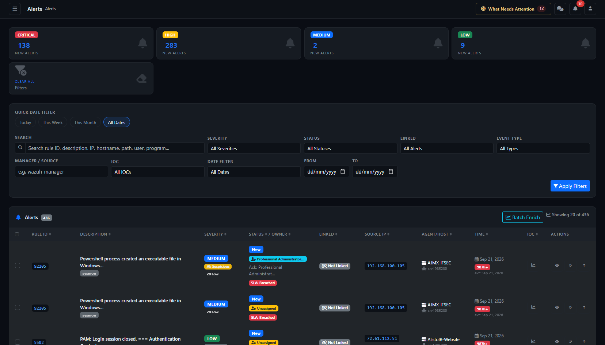
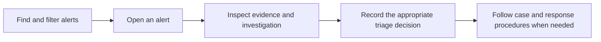

# Alerts — analyst and client guide

Page: `/alerts/index` on your AlistoIR server. Applies to Community 3.0.3. Actions depend on your role, the alert's status and access permissions.

## What is this page for?

The Alerts page is the central list for finding, prioritizing and opening security detections received by AlistoIR. Use it to narrow the workload, inspect ownership and SLA state, identify case links and IOC matches, and perform permitted triage actions.

An alert is a detection signal, not automatically a confirmed incident. Its severity, AI recommendation, risk score, alert status, case linkage and autonomous investigation status describe different things.

For the operational overview, read [Dashboard](DASHBOARD.md). For collection progress and analyst dispositions, read [Investigation Center](INVESTIGATION_CENTER.md).

## 1. New-alert severity cards

The top cards show **New Alerts** by Critical, High, Medium and Low severity within your access scope. They are not totals for every status, and their counts are not narrowed by all the filters currently applied to the table. Unknown severity can be selected through the filter even though it has no separate summary card.

Selecting a severity card opens that severity with **Status = New**. This shortcut does not preserve all your existing search/date selections, so check the resulting filters. **Clear All Filters** returns to the default listing.

### Severity colors on this page

| Label | Badge color | Meaning |
|---|---|---|
| Critical | Red | Highest recorded alert-severity category. Prioritize evidence review. |
| High | Yellow / warning | High-severity detection. |
| Medium | Blue / primary | Medium-severity detection. |
| Low | Green | Low-severity detection; this does not prove the activity is safe. |
| Unknown | Gray | Missing or unrecognized severity. |

Colors are contextual: the Attack Source Map uses a different palette for High and Medium. Read the written label rather than transferring a color meaning from another section. Severity itself does not establish maliciousness.

## 2. Filters and search

Filters combine to narrow the table. Select **Apply Filters** after editing fields. A date shortcut immediately navigates to that date selection and preserves the other applied query filters. Use **Clear** or **Clear All** to return to an unfiltered view within your access scope.

| Field | What it searches or selects |
|---|---|
| Search | Partial matches across rule description, source IP, Rule ID, hostname, manager/source, event type/action, MITRE technique and selected extracted path, user, program, PAM service and audit-key fields. It is not a full search of every raw-log field. |
| Severity | Low, Medium, High, Critical or Unknown. |
| Status | New, Investigating, Reviewed, Escalated, Resolved or Dismissed. |
| Linked | All Alerts, Linked Only or Unlinked Only, based on the presence of a case link. |
| Event Type | Available recorded event categories. Options depend on ingested data. |
| Manager / Source | Partial match against the recorded alert source string; suggestions come from available source values. It is not necessarily a live Wazuh connection name. |
| IOC | All IOCs, IOC Matched or No IOC Match, based on the alert's stored IOC-match flag. |
| Date Filter | All Dates, Today, This Week, This Month or Date Range. |
| From / To | Calendar dates used for a custom date range. |

Search is not a documented direct lookup of the internal AlistoIR Alert ID. Rule ID searches find detections of that rule, potentially many different alert records. Open the alert to identify its internal record reference for Investigation Center.

### Quick Date Filter and date behavior

- **Today** is the application-local calendar day.
- **This Week** is the calendar week starting Monday, not a rolling seven-day window.
- **This Month** is the current calendar month, not a rolling 30-day window.
- **Date Range** includes both selected calendar dates. If only one valid endpoint is supplied, it is used as a single-day range; reversed valid endpoints are normalized.
- The filtering window uses the alert's **received/created time**, not necessarily the original event timestamp.
- From/To fields entered without another date mode can select a custom range. Clear both dates when you intend All Dates.

The application converts the selected local-day boundaries for stored timestamp comparison. Check application timezone and received versus event time when searching across midnight or investigating delayed forwarding.

### Example searches

| Goal | Suggested approach |
|---|---|
| New high-priority work | Severity = Critical or High, Status = New, then verify the chosen date window. |
| Alerts needing case linkage | Linked = Unlinked Only, with a suitable status/date selection. Unlinked does not itself mean escalation is required. |
| A particular detection | Search for its Wazuh Rule ID, then compare hosts, times and evidence. |
| Activity on a host | Search the hostname, optionally add event type and dates. |
| File or account activity | Search an observed path, user or program; availability depends on supported extracted fields. |
| Recorded IOC hits | IOC = IOC Matched; open the records and validate relevance. |
| Locate a missing older alert | Clear filters and use All Dates before checking access scope and ingestion. |

## 3. Table columns

| Column | What it contains | How to use it |
|---|---|---|
| Selection checkbox | Available for permitted bulk-action users. Header checkbox selects rows on the current page. | Review the selection before any state change. |
| Rule ID | Detection rule identifier and, where available, a recurrence badge. | A rule can produce many distinct alerts; this is not the unique AlistoIR Alert ID. |
| Description | Shortened rule description with optional event type, Path and Program context. | Select the description to open the full alert. Missing context can reflect absent or unsupported event fields. |
| Severity | Recorded severity, optional AI badge and optional risk score. | Interpret each signal separately; definitions follow below. |
| Status / Owner | Alert status, assigned owner, acknowledgement information and available SLA state. | Check accountability and timing; an owner is not the same as the user observed in the event. |
| Linked | Linked / Not Linked case association, with an optional event Audit Key. | Linked does not mean closed, investigated completely or confirmed malicious. |
| Source IP | Recorded source address, with optional observed User and PAM service. | A dash can be valid for local/file events. The observed user is not the assigned SOC analyst. |
| Agent/Host | Hostname, falling back to agent ID where available, plus recorded source context. | Verify the affected endpoint before investigation or response. |
| Time | Received age, optional active-alert age badge and a separate event-age line. | Distinguish receipt delay from the event's actual timing. |
| IOC | Recorded IOC-match badge, or a Check Threat Intel action. | A match needs contextual validation; no stored match does not prove the alert is clean. |
| Actions | View and, where allowed, Dismiss or Escalate. | Use the detail view for evidence and deeper workflows. |

### Rule recurrence: `×/24h`

Where shown, this badge counts alerts for that rule in the last 24 hours within the query's access scope. It can exceed the number of rows currently visible because it is not a count limited to the current filtered page. It is a recurrence indicator, not a count of confirmed incidents or unique attackers.

## 4. Severity, AI verdict and risk score

### AI recommendation badge

A stored AI verdict is shortened into a compact badge:

| Badge | Color | Interpretation |
|---|---|---|
| AI: Malicious | Red | The stored text is classified into the malicious display category. Validate its supporting evidence. |
| AI: Suspicious | Yellow / warning | Activity warrants further scrutiny. |
| AI: Benign | Green | The stored text suggests a benign explanation; verify that explanation before disposition. |
| AI: Investigate | Blue/cyan information | Another verdict text falls into the general investigate display category. |

Hover to read the stored verdict and available confidence estimate. This is a shortened text-based display, not a replacement for the full assessment. A model confidence estimate is not measured verdict accuracy. A missing badge means no stored verdict is being displayed, not that the alert is benign.

### Risk score

Where present, the risk score is a **0–100 prioritization score**, with contributing context described in the tooltip: severity, IOC, privilege, public IP, MITRE and recurrence.

| Score | Label | Badge style |
|---|---|---|
| 80–100 | Critical | Red |
| 60–79 | High | Yellow / warning |
| 30–59 | Medium | Gray / secondary |
| 0–29 | Low | Dark |

Risk score, recorded severity and AI recommendation can differ. The score is not the probability that an attack succeeded. Open the alert to assess the original evidence and limitations rather than deciding from a single badge.

## 5. Alert status and accountability

| Alert status | Color | Practical meaning |
|---|---|---|
| New | Blue | Awaiting the appropriate triage workflow. |
| Investigating | Yellow / warning | Marked as being investigated. |
| Reviewed | Green | Marked reviewed; this does not itself establish a benign verdict or close a case. |
| Escalated | Red | Marked for escalation/further handling. This list action is a status update, not proof that a case was created. |
| Resolved | Green | Marked resolved in the alert workflow. Check the recorded evidence and linked case separately. |
| Dismissed | Gray | Removed from the active triage path through dismissal. Review the dismissal rationale; it is not a separate Investigation Center False positive decision. |

These statuses are different from investigation states such as Queued, Collecting, Completed or Inconclusive. A reviewed alert can still have unresolved evidence gaps. An alert disposition change may affect further automatic collection; inspect Investigation Center after changing active work.

### Owner, acknowledgement and SLA

- **Owner:** Assigned alert analyst, or Unassigned. The unassigned badge is highlighted for attention.
- **Ack:** Shows the recorded acknowledging user; hover for available acknowledgement details and time. It does not prove that all investigation steps were completed.
- **SLA:** Displays the alert's tracked SLA state when available. Use the alert details and Alert SLA workspace for the actual stage deadlines and breach reasons.

Permitted status updates can also record acknowledgement and SLA lifecycle events. They are operational actions, not merely visual labels. Do not change status solely to make a timer or counter look better.

## 6. Time and age color coding

The main relative time is based on when AlistoIR received/created the alert. Hover for Received and, when present, Event timestamps. The optional `evt:` line shows the separate event age if it differs.

For alerts in **New, Escalated or Investigating** status, an additional age badge is shown:

| Received age | Badge | Meaning |
|---|---|---|
| Less than one hour | Green, `< 1h` | Recently received active alert. |
| One hour to less than eight hours | Yellow, `< 8h` | Active alert has aged beyond one hour. |
| Eight hours or more | Red, an hours-plus label | Older active alert needing review. |

These are fixed display thresholds, not the alert's configured SLA deadlines. A green age badge can coexist with an SLA breach if a shorter target applies. Missing age badges for other statuses do not establish SLA compliance.

## 7. Open, enrich, dismiss or escalate

### View Alert

Select the description or eye icon. An **Opening alert...** overlay indicates navigation is loading; it does not mean an investigation has just started. In the detail page, review original evidence, AI reasoning, ownership, SLA, case context and investigation progress before deciding.

### Check Threat Intel

For rows without a stored IOC-match flag, the chart-style action requests IOC/threat-intelligence enrichment. A successful request refreshes the list. A notification may explain absent results or a failure.

Enrichment depends on available indicators, configured sources, connectivity and provider permissions/quotas. It is not the same as AI autonomous investigation. External reputation lookups may transmit indicators to those providers; the LLM privacy boundary does not cover all threat-intelligence APIs. Read [AI privacy](../docs/AI_PRIVACY.md).

The table header also links to **Batch IOC Enrichment**. This opens its own workflow; selecting it is not evidence that every alert has already been enriched.

### Dismiss Alert

For an authorized user and a New alert, the Dismiss action opens a confirmation dialog with the alert context and a reason field. Record an evidence-based reason and confirm only the intended alert. Dismissing does not delete the alert or record a separate Investigation Center analyst disposition.

### Escalate Alert

For an authorized user and a New alert, the upward-arrow action updates the alert to Escalated. Follow the case-management and response process separately. Escalation from this list does not, by itself, create a case, isolate a host or execute containment.

## 8. Bulk actions

Where your permissions allow them, check individual rows or use **Select all on this page**. The bulk toolbar displays the selected count.

| Action | Effect |
|---|---|
| Mark Reviewed | Applies Reviewed status to eligible selected records. |
| Escalate | Applies Escalated status to eligible selected records. |
| Dismiss | Opens a shared-reason dialog before applying Dismissed status. |
| Clear | Clears the selection without changing alert records. |

Selection is not a command to update every matching result across all pages. The server accepts at most 100 selected IDs per request and rechecks access. Some records can be skipped; for example, bulk updates do not reopen already-dismissed alerts into another status. Read the outcome rather than assuming every selected item changed.

Review context before applying one rationale to many alerts. Bulk status changes do not create individual case investigations or establish that all selected alerts share the same root cause.

## 9. Sorting, pagination and live refresh

Select a sortable column heading to order the list and toggle direction. Status and Owner have separate sort links even though they share a column.

The default order prioritizes unlinked alerts, then workflow status and severity, followed by newer received records. It is not simply newest-first. Choose Time sorting explicitly when you need chronological review.

Pagination shows the current page and total matching alert count. Page size follows the application configuration. Previous, Next and page links preserve applied query filters and sorting.

Automatic refresh normally runs about every 15 seconds on an active page, about 30 seconds when idle and 60 seconds when hidden, with additional delay after errors. It refreshes displayed counts/table data; it does not rerun an investigation. Rows can move as statuses, counts or data change. The interface attempts to preserve checked IDs that remain in the refreshed page, but always verify the selected count and rows before a bulk action.

## 10. Export to CSV and Print

**Export to CSV** creates a browser download from the currently rendered table text, including visible badge text. It is not a full database export, a raw-JSON export or an export of every result across all pages. Check its contents before using it as a report or importing it elsewhere.

**Print** opens the browser's print workflow for the current rendered page. Check the print preview for completeness and page layout.

Neither action automatically applies the external-AI sanitizer. Hostnames, IP addresses, user context and other displayed SOC data can be included. Store and share exports according to your organization's evidence and client-data policies; do not upload them unreviewed to public GitHub issues.

## 11. Suggested analyst workflow

1. Check scope and choose the intended date window.
2. Review New Critical/High alerts, then account for age and SLA priority.
3. Confirm the affected host, observed user, source and event time.
4. Open the alert and compare evidence, AI reasoning and any case links.
5. Inspect the autonomous investigation and unresolved evidence gaps.
6. Apply an appropriate alert status and rationale using your permitted workflow.
7. Record the separate investigation disposition, case updates and response approvals when required.
8. Verify the saved outcome; do not infer success from a loading overlay or a green badge alone.

For clients, explain the alert volume, triage state, evidence-supported conclusion and next action. Do not label every Critical alert, IOC match or high risk score as a confirmed breach.

## 12. Troubleshooting and interpretation

| Question / symptom | Explanation or next step |
|---|---|
| Severity-card counts differ from filtered table totals | The cards count New alerts by severity within scope; table filters can describe a different population. |
| A known alert is missing | Clear filters, use All Dates, check access scope, and compare received versus event time. |
| Search by an investigation reference or Alert ID finds nothing | Search is based on the supported fields, including Rule ID; use the original record link for a specific alert. |
| No Dismiss, Escalate or bulk controls | Check account permissions and, for single-row actions, whether the alert is still New. |
| No IOC Match | The stored match flag is not set. This is not proof of a clean result or completed enrichment. |
| Reviewed but still not linked | Review status and case association are independent. |
| AI badge looks different from the full assessment | It is a compact text-based category. Read the full verdict, evidence, gaps and update time. |
| CSV is smaller than the matching result count | It exports the displayed table, not all result pages. |
| Rows change while reviewing | Automatic refresh can reorder or replace the current page. Recheck selections before acting. |
| Security token invalid or expired | Refresh the signed-in page and retry the intended action; do not disable security controls. |
| Status change stops further automatic investigation | Analyst disposition can affect collection eligibility. Review the run and remaining tasks in Investigation Center. |

Continue with [Dashboard](DASHBOARD.md), [Investigation Center](INVESTIGATION_CENTER.md), [Investigation Settings](INVESTIGATION_SETTINGS.md), [Configuration](../docs/CONFIGURATION.md) or [Troubleshooting](../docs/TROUBLESHOOTING.md).
