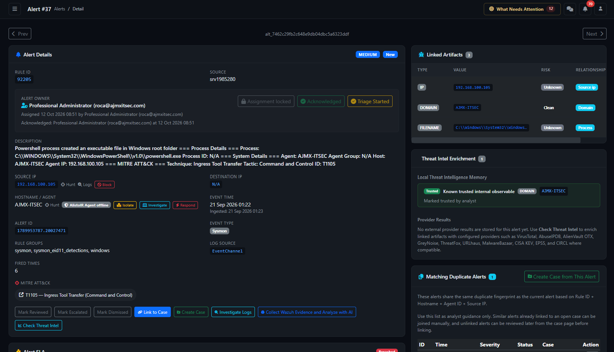

# Alert View — complete analyst and client guide

Page: `/alerts/view/` on your AlistoIR server. Applies to Community 3.0.3. Open an existing record from the [Alerts list](ALERTS.md); this page requires its alert identifier/reference. Panels and actions depend on permissions, payload data, endpoint mapping and integrations.

## What is this page for?

Alert View brings together the original detection, ownership/SLA, collected evidence, AI assistance, historical context, case associations and supported endpoint actions. It helps answer: **What happened, what evidence supports the assessment, what is missing, and what should happen next?**

| Item | Meaning |
|---|---|
| Alert severity / status | Detection priority and alert workflow state. |
| Autonomous investigation | Evidence collection, findings and decision readiness. |
| AI recommendation | Assessment of available evidence, with limitations. |
| Analyst review | A human decision and supporting rationale. |
| Case | Managed incident work and follow-up. |
| Response task | A requested endpoint action with its own approval, execution and result. |

A completed collection or AI recommendation does not establish that a human review, case closure or endpoint response occurred.

## 1. Navigation and alert identity

Open the description or eye icon in the Alerts list. The URL may use an AlistoIR reference or internal Alert ID. A Wazuh Rule ID identifies a detection rule and is not the unique alert record.

**Prev / Next** navigates neighboring accessible alert IDs; it does not necessarily preserve the Alerts list's filters/sort. Disabled buttons mean the corresponding neighbor is unavailable. A reference does not grant anonymous access: authentication and record-access checks still apply.

## 2. Alert Details

| Field | How to interpret it |
|---|---|
| Severity / Status | Recorded priority and workflow state; separate from AI verdict and investigation status. See [Alerts](ALERTS.md) for their color legends. |
| Rule ID / Source | Detection identifier and recorded manager/source context; not proof of current integration health. |
| Description / extra rule information | Explanation and additional metadata supplied with the detection. |
| Source IP / Destination IP | Event addresses. A source is not automatically an attacker; missing IPs can be normal for local events. |
| Hostname / Agent | Endpoint context. Verify it before investigation or response. |
| Event Time | Event-origin time where available. |
| Received At / Ingested | When AlistoIR received/created the record; forwarding delays can make it differ from Event Time. |
| Alert ID | Internal record ID used when starting an existing alert in Investigation Center. |
| Event Type / Rule Groups / Log Source | Available event classification and log-origin information. |
| Fired Times | Upstream detection-frequency context, not a count of confirmed incidents. |
| MITRE ATT&CK | Mapped/extracted technique context, not proof of a successful attack. |
| IOC Match Detected | Stored threat-intelligence match with available confidence; inspect its source and relevance. |

### Context shortcuts

- **Hunt:** Opens a hunt for the selected IP, host or hash where available.
- **Logs / Investigate Logs:** Pivots into related Wazuh records/timeline. Inspect the destination's actual scope and window.
- **External indicator links:** May open a reputation page such as VirusTotal. This is separate from LLM analysis.
- **Block:** Opens an endpoint IP-block request.
- **Investigate:** Opens an endpoint collection dialog.
- **Isolate / Release / Respond:** Opens the supported response workflow. Pending is not executed.
- **Agent/status badges:** Describe mapping or availability, not successful collection or response.

## 3. Alert Owner, acknowledgement and triage

The block shows the responsible analyst, assignment time/actor and acknowledgement details.

| Control | Meaning |
|---|---|
| Assign | Assigns the selected eligible account, or Unassigned where permitted. |
| Assign to me | Assigns the current user where permitted. |
| Assignment locked | Normal assignment controls are locked after acknowledgement. |
| Acknowledge | Available to the assigned analyst when eligible; records acknowledgement. |
| Start Triage | Requires acknowledgement by the assigned analyst. |
| Acknowledged / Triage Started | The milestone was already recorded; neither is a verdict. |

Follow this order: **verify the alert → establish ownership → acknowledge → start triage → assess evidence**. Disabled buttons can reflect another owner, missing acknowledgement, an existing milestone or permissions.

## 4. Alert status and analyst reasons

The page can offer **Mark New, Mark Reviewed, Mark Escalated and Mark Dismissed**, excluding the current state. Server-side permissions still apply.

The **Reason / Analyst Comment** dialog shows the transition and asks for a rationale, up to 1,500 characters. Confirm only the intended change. **Latest Analyst Reason** shows the latest stored transition, actor, time and note; fuller history appears below.

Reviewed does not mean Benign. Escalated does not prove a case or response was created. Dismissed is not the separate Investigation Center False positive disposition. A disposition change can stop further automatic collection; inspect existing evidence and in-flight work before changing an active alert.

## 5. Alert SLA

This tracks alert-handling responsibility and timing, separately from Case SLA and autonomous collection timeouts.

| Milestone | What to review |
|---|---|
| Responsible Analyst | Owner and any missing-owner/accountability warning. |
| Acknowledge | Deadline and recorded acknowledgement. |
| Start Triage | Deadline and triage-start milestone. |
| Disposition / Escalation | Due time and disposition/escalation completion. |
| Analyst Investigation / Disposition | Due time and recorded analyst investigation/disposition milestone. |

| SLA state | Color | Interpretation |
|---|---|---|
| On Track | Blue | Currently classified on track. |
| At Risk | Yellow | Approaching a configured deadline/risk threshold. |
| Breached | Red | A tracked deadline was breached; inspect the specific stage. |
| Completed | Green | Applicable SLA lifecycle completion is recorded; verify disposition. |
| Paused | Cyan/info | SLA tracking is paused where applicable; distinct from pausing collection. |
| Not Applicable | Gray | This SLA classification does not apply. |

Autonomous milestones may include **Autonomous queued, Collection started, AI assessment ready and Latest analyst review**. Elapsed time includes queue wait. Not recorded means that milestone is unavailable, not instantaneous.

**Alert SLA runs from ingestion until analyst disposition or escalation. Collection, AI completion and Inconclusive do not stop it.** The 30-minute collection timeout is separate. A legacy automatic completion record is audit context and does not complete analyst investigation. Case SLA applies under the case workflow when a case is created.

The **Case recommendation** explains whether to review existing candidates or consider a new case. Creating/linking still requires analyst action and does not automatically escalate the alert.

## 6. Asset Context

Displays detected identifiers and available CMDB matches, match method/confidence and asset details. **Open CMDB** opens asset management.

Match confidence concerns asset identification, not maliciousness. Verify identifiers before relying on business/ownership context. No match means no suitable CMDB enrichment was found, not that the host is necessarily unmanaged. If CMDB tables are unavailable, an administrator must complete supported installation.

## 7. Autonomous Investigation

| Area | How to read it |
|---|---|
| Status | Queued, Collecting, Evaluating, Completed, Inconclusive, Blocked or Cancelled describes the workflow, not threat outcome. |
| Decision readiness | Required and optional checks, limitations and readiness policy. A completed-check count is not evidence-quality certification. |
| Missing evidence and next collection steps | Follow the specific unresolved requirement. |
| MITRE investigation coverage | Available checks and baseline-only limitations for mapped techniques. |
| Collection steps | Result/error, limitations, expandable evidence and endpoint/Wazuh report links. |
| Adaptive findings / decisions | Bounded tool choices and reasoning where enabled; not authorization for arbitrary commands or containment. |

No run may be explained by disabled collection, rule exclusion, unsupported workflow, analyst disposition or pending discovery. Pausing retains evidence, and callbacks from dispatched tasks can still arrive.

Read [Investigation Center](INVESTIGATION_CENTER.md) for statuses and human review, and [Investigation Settings](INVESTIGATION_SETTINGS.md) for scope and pause/resume behavior.

## 8. Endpoint Investigation / Analyst Validation Panel

| Area | Context to validate |
|---|---|
| Host and Identity | Host, agent, observed account, logon context/ID. The event user is not the assigned SOC analyst. |
| Process and Execution | Process, command line, parent and execution metadata. |
| Decoded PowerShell Analysis | Safely decoded text and indicators. Decoding does not execute the command or establish that it is harmless. |
| Network and Event | Source/destination, ports/protocol and event source. |
| Hashes | Available file hashes and hunt pivots. Missing hashes remain gaps. |
| Signals Present | Derived red flags, not a complete malware assessment. |
| What to Validate Next | Suggested checks based on available fields and limitations. |
| Recent Related Alerts on the Same Endpoint | Recent context, including a seven-day lookup. Related does not prove a shared cause. |

**No strong endpoint-only red flags** is not a clean verdict. Confirm user intent, process legitimacy, authorization and history. Historical event fields also may not reflect the endpoint's current state.

### AI Endpoint Investigation Recommendation

Shows a suggested collection type, recommendation strength, validation details and inputs such as process, hash, network path, metadata, timeline, Copilot and existing endpoint results. Recommendation strength is not a compromise probability.

The automatic-collection message can explain disabled settings, analyst disposition, collector-event suppression, missing verified scope or existing attempts. The worker starts supported process, file and event-log recommendations when eligible. **Run Recommended** supports analyst-directed collection and other available profiles under normal validation. Existing attempts may be reused; failed/unavailable evidence stays visible.

### Endpoint Triage Reports

Shows report/task, status, endpoint, created time, result availability and an **Open** action. **View All** opens endpoint history. Waiting means a usable result is not yet shown. Available means it can be inspected, not that its findings are benign.

## 9. Collect endpoint evidence

Select **Investigate** and verify the exact endpoint/agent and manager. **Use native AlistoIR endpoint agent** selects a different collection transport; it does not enroll an endpoint or repair connectivity.

| Investigation Type | Purpose / important context |
|---|---|
| Quick Triage | Broad process, network, service, user, startup and log context. |
| Suspicious Process | PID/path with process tree, file, network and persistence context. |
| Suspicious File | Path/hash, signature, metadata and persistence relevance. |
| Network Connection | Connection, owning process and available DNS/ARP context. |
| Persistence | Supported services, tasks, startup/autorun and other persistence entries. |
| Event Log Collection | Safe read-only Windows event or Linux log filters and time constraints. |
| Browser History | Hours back, record limit, optional endpoint user, visits/downloads/search selections and URL-query redaction. |
| Evidence File Acquisition | Path and bounded acquisition options; metadata/hash and size-limited content where allowed. |
| YARA Scan | Rule or keyword with bounded file scope. If YARA is unavailable, a bounded literal-scan fallback may be used; that is not equivalent to a full YARA engine. |
| Post-Remediation Validation | Selected process/file/network/persistence recurrence and endpoint-security checks. |

Context fields change with the selected type. Use the narrowest relevant endpoint, process, path and time range. Browser history and acquired files can contain client/user-sensitive content; collect only within authorized investigation scope. The browser collector targets alert browser context first where available and is designed to avoid credential/session stores. URL-query redaction does not make all history non-sensitive.

**Investigation Profile** describes the baseline; **Investigation Type** controls the task. Supported collectors use signed, parameter-validated tasks rather than arbitrary shell commands. **Start Investigation** submits work; **View History** opens progress/results. Verify returned reports, timestamps, errors and coverage before relying on a result.

## 10. Wazuh evidence and AI report

**Investigate Logs** pivots into related Wazuh records/timeline. **Collect Wazuh Evidence and Analyze with AI** opens time-bounded Indexer collection and AI reporting for eligible Wazuh-origin alerts.

This differs from live endpoint collection and needs working Indexer access plus retained relevant records. A successful Manager API test does not prove Indexer/search readiness. Automatic investigation may already have created a report; inspect its references and freshness before repeating work.

Archives, retention, permissions and result limits affect coverage. No returned events does not prove no activity occurred. Review the report's scope, gaps and cited evidence.

## 11. AI Copilot

**Generate Brief / Refresh Brief** requests the available analysis path. It can reuse cached output or queue work, so inspect generated time and evidence freshness. Repeated clicks do not guarantee new collection or a new provider response.

| Output | How to interpret it |
|---|---|
| Verdict | Evidence-constrained model recommendation, not the human decision. |
| Confidence | Model estimate, not measured accuracy or probability of a successful attack. |
| Analyst Priority | Suggested priority, not assignment or response execution. |
| Prior Analyst Context | Alert status, latest analyst decision and recorded changes to consider against current evidence. |
| Why This Verdict | Reasoning to verify against source records. |
| Endpoint Investigation Assessment | Assessment of available endpoint results and gaps. |
| MITRE Techniques Detected | Technique context requiring verification of actual behavior. |
| Key Suspicious Indicators | Validation leads, not standalone proof. |
| Summary / Risk Assessment / Recommendation | Explanation and suggested next steps; no response is executed by this text. |

A valid raw payload and working permitted provider path are required. Missing required evidence can cause a benign model suggestion to be held as **Needs Investigation**. Do not convert that into a false-positive decision without verification.

### Shared evidence scope and limitations

Copilot, Timeline Copilot and the Investigation Assistant share aligned context/readiness checks. Related-event matching uses the same tenant, manager, agent and host within **±30 minutes of the reference event**, with bounded event/report samples. This is not a complete search of every log or endpoint.

Autonomous evidence, endpoint/Wazuh reports, artifacts, threat intelligence, CMDB, custom fields and analyst review can contribute. Truncation, omitted records and lookup failures remain limitations. Inspect cited records locally rather than assuming the model received everything visible in the application.

## 12. Follow-on Event Correlation / Timeline Copilot

**Analyze Timeline / Refresh Timeline** examines observed related events for successful access, execution, privilege escalation, process chains and possible lateral movement. Outputs can include verdict, confidence, priority, reasoning, detected behaviors, correlated Alert IDs, Observed Next Events, summary, lateral-movement/process-chain assessments and recommendations.

This is correlation, not prediction. Check event times/offsets to distinguish events before and after the reference alert, and follow correlated-alert links to verify records.

Some helper text refers to a next-hour timeline; the aligned snapshot uses the **±30-minute window and bounded samples above**. Do not assume exhaustive coverage of a full following hour. A separate log-investigation pivot can use its own window.

Missing events or incomplete coverage cannot establish no escalation; the result can be **Inconclusive**. No observed follow-on detection does not establish benign behavior.

## 13. AI Investigation Assistant

The floating robot opens an alert-aware assistant. It explains the alert, evidence, indicators, MITRE context, available reputation and next investigation steps, and can offer related-alert search links.

| Quick action | Use |
|---|---|
| Verdict | Ask which conclusion is supported and what is missing. |
| Investigation | Ask which check to perform next and why. |
| Reputation | Review available indicator reputation and limitations. |
| Find Similar | Request related-alert search context; inspect returned filters/time range. |

Type a question and select **Send**; the interface accepts plain English or Taglish. Suggestions do not execute containment. Searches remain access-controlled and can use a separately requested search window rather than the core assessment's ±30-minute snapshot.

The assistant does not replace original evidence, human review or approval. Do not paste credentials into chat to make an investigation work.

## 14. Readable JSON View and Raw JSON Payload

**Readable JSON View** reformats payload fields for triage; it does not add independently verified facts. **Raw JSON Payload** shows the underlying event, with a **Copy** control.

Compare extracted fields with the original event when values are missing, transformed or ambiguous. Raw content can include untrusted instructions, encoded commands or secrets; treat it as evidence, not executable commands or authoritative directions.

Copying JSON does not apply the outbound-AI sanitizer. Review/sanitize before sharing outside the authorized investigation. Invalid JSON can prevent AI context generation and should be raised with the ingestion administrator.

## 15. Linked Artifacts and Threat Intel Enrichment

### Linked Artifacts

The table lists **Type, Value, Risk and Relationship**, with a detail action where available. It shows linked observables, not every string in the payload. No linked artifacts does not mean no useful indicators exist.

### Threat Intel Enrichment

| Area | Meaning |
|---|---|
| Local Threat Intelligence Memory | Trusted designation, risk/confidence, sightings, alert/case counts and Last Seen where stored. |
| Provider Summary | Aggregated reputation context and scores. |
| Provider Results | Provider, artifact, reputation, score and available external reports/details. |
| Local IOC Feed Matches | Source, indicator, threat classification and confidence of local matches. |

Trusted internal observable is context, not proof the current activity is authorized. Provider scales differ, and old/shared indicators need event-specific interpretation.

**Check Threat Intel** requests supported local/provider enrichment. Indicator compatibility, credentials, connectivity and quotas affect results. Empty results can mean enrichment has not run or is unavailable; they are not a clean finding. These API lookups are separate from LLM requests and may send indicators to their providers.

## 16. Cases, duplicates and historical outcomes

| Section / action | Meaning |
|---|---|
| Suggested Open Cases | Active-case candidates with duplicate-style matches. Validate relevance before linking. |
| Prior Same Alert Outcomes | Matching-fingerprint history with available analyst status, AI verdict, closed-case context, notes or resolution. |
| Matching Duplicate Alerts | Alerts sharing the fingerprint, with time, severity, status, case and links. Matching fingerprints do not prove identical cause. |
| Linked Cases | Cases already associated with this alert; open each for its own status/tasks. |
| Link to Case | Select an eligible active case. Suggested labels indicate matching-alert context. |
| Create Case | Opens case creation prefilled from the alert where eligible; review before submitting. |

A previous False Positive, Benign assessment or closed case is reference context, not an automatic decision for the current event. Verify host/user, time, authorization and current evidence.

The normal UI disables linking dismissed alerts and shows Linked to Case when already linked. Creating/linking does not automatically escalate the alert or execute response. Investigation review does not close linked cases. Review suggestions before creating another case.

## 17. Custom Fields, Quick Info and Analyst Notes & History

- **Custom Fields → Edit:** Configured extra fields; types, options and required markers depend on deployment settings. Save accurate context, avoiding credentials and unnecessary sensitive data.
- **Quick Info:** Internal Alert ID, Agent ID, available First Seen, Received At, Wazuh status and IOC Matched. First Seen is derived alert context, not proof of the earliest occurrence anywhere in the environment.
- **Analyst Notes & History → Save Note:** Records observations and rationale. Entries can show status transitions, actor and time. Saving a note alone does not execute response or update every related record's status.

Separate verified observations from hypotheses. Record supporting references, unresolved gaps and the next owner/action.

## 18. Response: blocking, isolation and remediation

These controls can change endpoint behavior. They are separate from read-only collection and AI recommendations. Verify endpoint, transport, indicator, reason and the returned approval/result state.

### Request IP Block on Endpoint

Select the IP, exact endpoint/Wazuh mapping or native transport, direction (**Both, Inbound or Outbound**) and the duration offered (**1 hour, 24 hours, 7 days or 30 days**). Add notes explaining purpose/scope.

**Auto-add endpoint from alert** assists mapping; confirm agent and manager rather than assuming the first match is correct. Blocking targets the selected endpoint, not automatically every device on the network.

Approval/dispatch depends on role and policy: analyst requests can await approval, while permitted manager/admin Wazuh requests can dispatch directly. Native transport has its own task flow. Submitted, pending approval and executed are different states; read the actual result.

### Isolate / Release Endpoint

Isolation restricts endpoint network access through the supported Wazuh/native approval workflow. Verify target, optional **Additional Allowlist** and notes. The allowlist supports exact addresses/hostnames, not URLs, wildcards, CIDR ranges or Any. Enforced control/management reachability protections remain.

**Isolation Pending** is not confirmed isolation. Verify approval, execution and endpoint result. **Release** requests restoration through the supported workflow; verify connectivity afterward. Selecting a transport does not create endpoint enrollment or connectivity.

### Respond dialog

| Response Action | Key context and controls |
|---|---|
| Terminate Process | PID or process path, optional process-tree/force choices, target and reason. |
| Quarantine File | File path and supported evidence/related-process options. Verify task evidence before assuming containment. |
| Disable Persistence | Supported entry type/name/location and backup option. |
| Restore Quarantined File | Quarantine identifier and offered post-restore validation options. |
| Restore Persistence | Corresponding backup identifier and supported restore context. |

Containment/rollback actions are approval-gated. Follow approval/task history: a recommendation, queued request or successful submission is not execution proof. Use **Post-Remediation Validation** after changes. Its result applies to selected checks and scope, not every possible persistence mechanism.

## 19. Refresh, troubleshooting and privacy

Panels can refresh independently: autonomous status, endpoint results and cached AI outputs need not change together. Collapsing a panel hides it; it does not pause work. Check recorded times and results before repeating requests.

| Symptom | What to check |
|---|---|
| Assignment locked / cannot acknowledge | Owner and existing acknowledgement; normal reassignment locks after acknowledgement. |
| Start Triage disabled | The assigned analyst must acknowledge first; check account permission. |
| Queued / Waiting | Worker, enabled collection, rule scope, endpoint availability and budgets. |
| No endpoint report | Mapping, collector setup, HTTPS callback trust, task result and timeout. |
| AI unavailable / still queued | Provider configuration, balance/quotas, worker outcome and cached-output freshness. |
| Inconclusive / Needs Investigation | Resolve explicit gaps or record the need for further investigation. |
| Security validation failed | Refresh the signed-in page and retry the intended action. Do not disable CSRF/integrity controls. |
| Pending approval | Complete the authorized approval workflow, then verify dispatch and endpoint result. |
| No duplicate/history matches | No records matched the lookup scope/rules; this does not prove a first-ever occurrence. |
| Alert and case outcome differ | They are separate records/workflows; review and update deliberately. |

Community 3.0.3 sanitizes AIService content before submission. Recognized secrets are withheld, recognized identities/network values can receive aliases, and identified raw logs/notes can be withheld. Aliases are not actionable IPs or IOCs: inspect local cited evidence for originals. Privacy omissions can limit the assessment.

This is not universal DLP and does not automatically sanitize **Copy, notes, exports, external report links or every threat-intelligence API**. Read [AI privacy](../docs/AI_PRIVACY.md) and its limitations before external-provider use with client evidence.

## 20. Analyst completion and client handover

1. Verify alert identity, host/agent, manager and event/receipt times.
2. Establish ownership, acknowledge and start triage as appropriate.
3. Review original evidence, asset context, investigation findings and gaps.
4. Validate Copilot/Timeline reasoning against cited records and actual scope.
5. Use reputation and previous outcomes as context, not automatic verdicts.
6. Record alert rationale and the separate Investigation Center disposition where applicable.
7. Link/create the appropriate case and manage follow-up through that workflow.
8. Confirm response approval, execution evidence and post-change validation.
9. Document remaining uncertainty and the next owner/action.

For clients, report the observed signal, verified findings, limitations, analyst conclusion and actual response state. Do not say blocked, isolated, resolved or false positive solely because the AI recommended it.

Continue with [Alerts](ALERTS.md), [Investigation Center](INVESTIGATION_CENTER.md), [Investigation Settings](INVESTIGATION_SETTINGS.md), [Dashboard](DASHBOARD.md), [Wazuh setup](../docs/WAZUH_SETUP.md) and [Troubleshooting](../docs/TROUBLESHOOTING.md).
