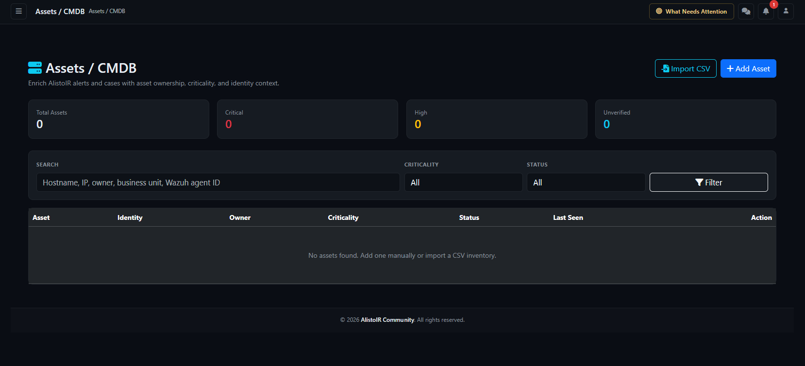

# Assets / CMDB — analyst and administrator guide



Page: `/cmdb/index` on your AlistoIR server. Applies to Community 3.0.3. Add, Edit and Import require CMDB management permission; read-only users will not see every control.

<!-- toc:start -->

## Table of contents

- [What is the CMDB?](#what-is-the-cmdb)
- [1. Page controls and permissions](#1-page-controls-and-permissions)
- [2. Summary cards](#2-summary-cards)
- [3. Search, filters and ordering](#3-search-filters-and-ordering)
- [4. Inventory columns](#4-inventory-columns)
- [5. Color coding and meanings](#5-color-coding-and-meanings)
  - [Asset Criticality](#asset-criticality)
  - [Asset Status](#asset-status)
- [6. Add Asset or Edit](#6-add-asset-or-edit)
  - [Asset Identity fields](#asset-identity-fields)
  - [Business Context fields](#business-context-fields)
  - [Risk Profile fields](#risk-profile-fields)
- [7. How assets match alerts and cases](#7-how-assets-match-alerts-and-cases)
- [8. View an asset](#8-view-an-asset)
- [9. Import CSV](#9-import-csv)
  - [Matching and update behavior](#matching-and-update-behavior)
- [10. Inventory quality and maintenance](#10-inventory-quality-and-maintenance)
- [11. Troubleshooting](#11-troubleshooting)

<!-- toc:end -->

## What is the CMDB?

CMDB means **Configuration Management Database**. In AlistoIR, it is an asset inventory that connects technical identifiers to ownership and business importance. It helps an analyst understand **which asset an alert concerns, who owns it and why it matters**.

An alert about a production payment server can require different handling from similar activity on a lab workstation. CMDB supplies that context; it does not independently confirm maliciousness, detect every asset or replace endpoint monitoring.

| Concept | Meaning |
|---|---|
| Asset identity | Hostname, FQDN, IP, MAC address, Wazuh Agent ID and platform details. |
| Business context | Owner, business unit, environment, location and data classification. |
| Risk profile | Recorded criticality, exposure and lifecycle status. |
| Alert/case association | A relationship built from matching identifiers or case links. |

**Asset owner is not the assigned SOC analyst. Asset Criticality is not alert severity, AI confidence or a vulnerability score.**

## 1. Page controls and permissions

| Control | Behavior |
|---|---|
| Add Asset | Opens a new asset form for authorized managers. |
| Import CSV | Opens inventory import; matching records can be updated. |
| Search / Criticality / Status | Narrows the displayed inventory. |
| Filter | Applies the selected filters. |
| View | Opens asset details, identifiers, IP history and related records. |
| Edit | Opens the asset form for an authorized manager. |

Sign-in is required. Inventory visibility depends on account/tenant configuration; a platform account can have a wider view than an ordinary account. Missing management controls can reflect permissions rather than a broken page.

If the CMDB database tables are unavailable, the page displays a setup notice. Have the installation administrator complete the supported database setup; analysts should not run example SQL against an unverified database or edit protected application files.

## 2. Summary cards

| Card | What it counts |
|---|---|
| Total Assets | All inventory records in the inventory's applicable tenant scope. |
| Critical | Records whose asset Criticality is Critical. |
| High | Records whose Criticality is High. |
| Unverified | Records whose asset Status is Unverified. |

These counts are separate from the current Search/Criticality/Status table filters. They can include Retired or Merged records; Critical and High are not active-only counts. A card can therefore exceed the number of displayed rows.

These are inventory counts, not live endpoints, confirmed incidents, vulnerability findings or a discovery-coverage percentage.

## 3. Search, filters and ordering

| Field | Behavior |
|---|---|
| Search | Partial matching across asset name, hostname, FQDN, IP address, Wazuh Agent ID, owner name, business unit and tags. |
| Criticality | All, Critical, High, Medium or Low. |
| Status | All, Active, Unverified, Retired or Merged. |

Filters combine. Search is not a full search of every field: owner email, notes, OS and location are not part of this list's search expression. Clear the text and select All filters, then select Filter, to broaden the view.

The list prioritizes Critical, High, Medium and Low, then recent Last Seen/updated context, then asset name. It is limited to **250 returned assets**, with no pagination control on this page. Narrow filters when reviewing a large inventory; a missing row is not proof the asset does not exist.

## 4. Inventory columns

| Column | Contents / interpretation |
|---|---|
| Asset | Asset name, type and OS where present. |
| Identity | Hostname, falling back to FQDN, then IP and Wazuh Agent ID where present. |
| Owner | Owner name, followed by business unit or environment. Unassigned means no owner name is stored, not no SOC analyst is assigned. |
| Criticality | Recorded business importance of the asset. |
| Status | Recorded lifecycle/verification state. |
| Last Seen | Relative age of the stored timestamp, or Never if absent. |
| Action | View and, where permitted, Edit. |

Missing IP/hostname is an inventory-data gap. **Last Seen is not a guaranteed agent heartbeat**: it can be entered/imported and can change through supported alert-enrichment activity. Never does not prove the asset has never existed or never communicated.

## 5. Color coding and meanings

### Asset Criticality

| Value | Color | Practical interpretation |
|---|---|---|
| Critical | Red | Highest recorded business importance; validate impact and handling priority. |
| High | Yellow/warning | Important asset requiring appropriate prioritization. |
| Medium | Cyan/info | Medium recorded business importance. |
| Low | Gray | Lower recorded importance; not a statement that threats are absent. |

### Asset Status

| Value | Color | Interpretation |
|---|---|---|
| Active | Green | Recorded as an active inventory asset, not necessarily online now. |
| Unverified | Yellow/warning | Identity/context requires verification. This does not mean infected. |
| Retired | Gray | No longer considered current inventory; normal automatic asset matching excludes retired records. |
| Merged | Cyan/info | A lifecycle label. Selecting it does not execute a record merge, deduplicate history or reassign links. |

Merged is not a substitute for Retired and should not be assumed to disable matching. Use a controlled inventory-maintenance process for duplicates. This page has no dedicated merge or delete action.

## 6. Add Asset or Edit

Select Add Asset, or Edit beside an existing record. The form groups fields into Asset Identity, Business Context and Risk Profile.

### Asset Identity fields

| Field | Purpose |
|---|---|
| Asset Name | Human-readable name; required by the manual form. |
| Asset Type | Description such as endpoint, server, firewall or cloud; this does not enroll a collector. |
| Hostname | Endpoint's short hostname; use a consistent value matching real telemetry. |
| FQDN | Fully qualified DNS identity where applicable. |
| Wazuh Agent ID | Agent identifier used in Wazuh context; preserve its correct formatting. |
| IP Address | Recorded address; account for DHCP, NAT and reassignment. |
| MAC Address | Hardware/network identifier where applicable. |
| OS / Platform | Operating-system or appliance-platform description. |

### Business Context fields

| Field | Purpose |
|---|---|
| Environment | Production, Lab, Branch or another deployment context. |
| Business Unit | Team/function responsible for or dependent on the asset. |
| Location | Physical or logical location. |
| Owner Name / Owner Email | Business/technical contact; not automatic SOC alert assignment or notification delivery. |
| Data Classification | Recorded sensitivity label, such as Internal or Confidential. It does not enforce encryption or DLP. |
| Tags | Inventory categorization; do not assume case-tag dashboards use these asset tags. |
| Last Seen | Known inventory observation time; do not fabricate a timestamp merely to make the record appear current. |
| Notes | Relevant context and maintenance facts, excluding passwords/tokens. |

### Risk Profile fields

- **Criticality:** Critical, High, Medium or Low; the manual default is Medium.
- **Exposure:** Internal, External or Unknown; the form default is Internal. This is declared context, not a live firewall/Internet-exposure scan.
- **Status:** Active, Unverified, Retired or Merged; the manual default is Active.

Review all fields before **Create Asset / Save Changes**. Saving does not configure Wazuh, install an agent, isolate an endpoint, change every alert's severity or guarantee immediate regeneration of all AI summaries.

## 7. How assets match alerts and cases

AlistoIR extracts candidate identifiers from alert/endpoint context and compares them with stored asset identities/identifier records. Agent IDs, hostnames/FQDNs, MAC and IP context can contribute with different confidence weights.

The asset match shown in Alert View includes its matching identifier and available confidence. **That percentage concerns identity association, not maliciousness or incident certainty.** Shared/reused IPs, duplicate hostnames and recycled agent IDs need analyst verification.

Identifier records and IP history can be retained as inventory changes. Editing one primary field does not imply old aliases/history were purged. Review Known Identifiers and IP History after correcting identity or reassignment issues.

Asset business context can help alert/case AI explain impact where it is included, but it does not replace evidence or human approval. Related cases can arise through direct asset links or alerts linked to the asset. A case/alert association does not prove the asset is compromised.

## 8. View an asset

| Section | What to review |
|---|---|
| Asset Summary | Type, OS, Wazuh Agent ID, FQDN, MAC, exposure, environment, classification, location, tags, Last Seen and notes. |
| Risk and Ownership | Criticality, status, owner/contact and business unit. |
| Known Identifiers | Stored aliases/identifiers, confidence and provenance information where shown. |
| IP History | Recorded addresses and observation history; not proof of current reachability. |
| Related Alerts | Recent associated alerts, severity, matching identifier/confidence and creation time. |
| Related Cases | Associated case references, severity, status and creation time. |

The related-alert/case lists are bounded recent views, not a guarantee of exhaustive history. Open a record to verify its evidence and permissions. An empty list can mean associations have not been created, not that the asset has no security activity.

## 9. Import CSV

The import is an **upsert workflow**, not an append-only upload. It can create new assets and overwrite fields on matched assets.

1. Start with an inventory owned/verified by your organization and back up records before a large update.
2. Review the [fictional CSV example](examples/cmdb-assets-example.csv). Replace all sample values before using it for real inventory; it is not a discovery feed.
3. Use the supported header names below and save as a plain UTF-8, comma-separated CSV. Quote values containing commas, such as a tag list.
4. Open Import CSV, choose the file and select **Import Assets**. This form submits the import; it is not a preview screen.
5. Inspect the **created, updated and skipped** counts, then check affected assets, identity mappings and context.

```text
asset_name,hostname,fqdn,ip_address,mac_address,wazuh_agent_id,os_name,asset_type,environment,business_unit,owner_name,owner_email,data_classification,criticality,exposure,location,status,tags,notes,last_seen_at
```

Unknown headers are ignored. Header names are normalized to lowercase/trimmed text. For predictable imports, use the exact names shown. Spreadsheet formatting can alter agent IDs or timestamps; preserve identifiers as text.

### Matching and update behavior

The importer looks for an existing record in this order: **Wazuh Agent ID → FQDN → Hostname → MAC Address → IP Address**, using non-empty matching values. The first identified match is updated. Asset Name alone is not the duplicate-matching key.

Check identifier uniqueness and ownership before import, especially when IPs or agent IDs have been reused. Do not assume CSV import is a cross-client inventory reconciliation tool.

Omitted/blank fields are **not a guaranteed preserve-existing patch**. Updates write the normalized asset payload, so empty/missing values can clear context or apply defaults such as Medium criticality, Internal exposure and Active status. Include verified values for fields you need to retain.

Rows without a usable asset name or fallback hostname/FQDN/IP can be skipped. A failed import is not a guaranteed all-or-nothing rollback; inspect the inventory before retrying because earlier rows may already have changed records.

## 10. Inventory quality and maintenance

- Use stable identifiers and verify duplicated hostnames, agent IDs and IPs.
- Keep ownership, classification and business criticality current.
- Record uncertainty as Unverified rather than inventing identity confidence.
- Retire assets deliberately when they leave service, preserving relevant history.
- Review old aliases/IP history after readdressing or rebuilding endpoints.
- Import complete, reviewed updates rather than treating missing columns as unchanged fields.
- Avoid storing passwords, provider tokens, private keys or unnecessary personal details in Notes/custom inventory labels.

CMDB context can be used in AI analysis, but Copy, CSV import and local inventory display are not automatically sanitized by the external-AI gate. Read [AI privacy](../docs/AI_PRIVACY.md) for the boundary and limitations.

## 11. Troubleshooting

| Symptom | What to check |
|---|---|
| No assets found | Clear filters, confirm the relevant account/tenant context and verify records were created/imported. |
| Summary count differs from rows | Cards ignore table filters, and the list has a 250-record limit. |
| No Add/Edit/Import controls | Your account needs CMDB management permission. |
| CMDB database tables not installed | Ask the installation administrator to complete supported setup; do not edit protected code to hide the warning. |
| Security validation failed | Refresh the signed-in form and retry. If persistent, use CMDB Session Check with the administrator; do not disable CSRF. |
| Asset fails to match an alert | Compare exact agent/host/FQDN/IP context, retirement state and identifier history. |
| Asset matches the wrong host | Investigate shared/reused identifiers and known aliases before relying on the enrichment. |
| Active but endpoint offline | Active is inventory lifecycle, not agent presence. Check Wazuh/endpoint health separately. |
| Last Seen says Never | No timestamp is stored; not proof the host never existed. |
| Import updated instead of created | An identifier matched an existing asset. Review the import matching order and affected record. |
| Fields changed after a partial CSV | Missing/blank fields can overwrite context or apply defaults; restore verified data and correct the import. |
| Merged selected but duplicates remain | The status label does not perform an automatic merge. |

For clients, describe CMDB as business/identity context supporting the investigation. Do not present its criticality or Active badge as confirmation of compromise, remediation or complete asset coverage.

Continue with [Alert View](ALERT_VIEW.md), [Investigation Center](INVESTIGATION_CENTER.md), [Configuration](../docs/CONFIGURATION.md) or [Troubleshooting](../docs/TROUBLESHOOTING.md).
