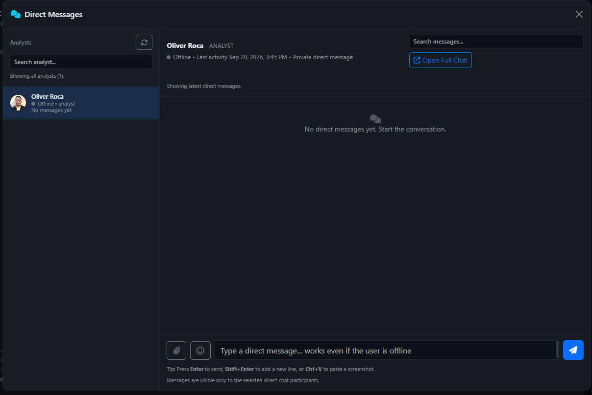

# Direct Messages — one-to-one collaboration guide

Applies to AlistoIR Community 3.0.3. Open **Direct Messages** from the header's chat icon, or select **DM** beside an eligible user in [Analyst Chat](CHAT.md).

## What are Direct Messages?

Direct Messages are one-to-one conversations between eligible AlistoIR users. Use them for coordination, clarification and handovers without posting the conversation to a team channel.

They are not the AI Investigation Assistant and do not create formal alert acknowledgement, analyst disposition, case closure or response approval. Record those actions through their actual workflows.

## 1. Open a conversation

1. Sign in and select the header chat icon to open the **Direct Messages** window.
2. Use **Search analyst...** or the user list to find an eligible recipient.
3. Select the recipient and verify the name in the conversation header.
4. Enter the message and select Send, or press Enter.
5. Confirm the message appears in the correct conversation.

A recipient can be offline; the interface supports sending to an eligible active account while that user is not currently online. Offline does not mean the account is disabled. Sending to yourself or an inaccessible/inactive account is not a supported normal conversation.

**Open Full Chat** opens the full Chat workspace. Confirm the selected room there rather than assuming the compact window's recipient was automatically carried over. The full page can show a **1:1 Chat** badge for a direct room.

## 2. Window controls

| Area / control | Meaning |
|---|---|
| Analysts | Available eligible users, presence and unread indicators where shown. |
| Refresh users button | Reloads the recipient list; does not send a message or restart an investigation. |
| Search analyst... | Narrows the displayed recipient list. |
| Active conversation header | Identifies the selected peer; check before sending client-specific information. |
| Search messages... | Filters conversation messages available to the current view; not a guaranteed full-history search. |
| Message area | Text, author/time, reply context, attachments and available message actions. |
| Replying To banner | Identifies the message referenced by your next reply. Cancel it to send normally. |
| Paperclip | Selects a supported attachment. |
| Emoji button | Inserts a quick emoji into your text. |
| Send / paper plane | Submits the composed message. |
| Open Full Chat | Opens the larger collaboration workspace. |
| Close | Hides the window; it does not delete the conversation or recall sent messages. |

Composer controls remain disabled until a valid conversation is selected. Message text is limited to **2,000 characters**. Enter sends, Shift+Enter adds a line break, and supported screenshot paste uses Ctrl+V.

## 3. Who can message whom?

DM pairing is checked server-side using the current tenant/account context and allowed group relationships. In the current group-pairing rules:

- Two users with compatible overlapping configured groups can communicate.
- If both users have no configured groups, pairing can be allowed.
- If only one user has groups, or the configured groups do not overlap, pairing is not allowed.

A user who is visible in another team view is not necessarily an eligible DM peer. Missing users can reflect inactive accounts, tenant/group scope or recipient-list limits. Ask the administrator to review legitimate membership; do not change identifiers or use another person's account to bypass access.

Group pairing does not grant access to alert/case records linked in a message. Recipients still need their own permission to open those records.

## 4. Presence, typing, unread and seen

| Indicator | Interpretation |
|---|---|
| Online / green presence | Recent application activity, not a guarantee of availability or an accepted task. |
| Offline / gray presence | No current qualifying presence signal; eligible offline accounts can still receive stored messages. |
| Typing / replying | A short-lived client/application signal. It does not guarantee a message will be sent. |
| Unread badge/count | Application-tracked unread chat notification/context. It can lag polling or change when the conversation is fetched/opened. |
| Seen/read indication, where shown | The application recorded a conversation-view/fetch milestone. It is not proof of comprehension or formal incident acknowledgement. |

Opening/fetching the selected conversation can mark its chat notifications and seen state. Do not interpret this as the recipient acknowledging an alert SLA, accepting case ownership or approving containment.

The compact conversation normally polls about every 3 seconds while active, slowing with idle/hidden state to roughly 6–20 seconds and backing off after errors. The header unread/notification indicators can refresh on a different schedule. This is not a guaranteed instant-delivery or emergency escalation channel.

## 5. Reply, react, edit and delete

- **Reply:** References a visible message through the Replying To banner; verify the selected parent before sending.
- **React:** Adds/toggles an offered reaction. A thumbs-up or other reaction is not an application approval action.
- **Edit:** Available for your own messages under the server's **15-minute** edit limit.
- **Delete:** Normal controls operate on your own accessible messages. Follow errors if the backend rejects a change.

Deletion does not promise erasure of recipient copies, notification previews, forwards, screenshots or backups. Editing/deleting chat also does not correct decisions already recorded in an alert or case.

## 6. Share a direct message

Where available, **Share** forwards one of **your own** direct messages to another eligible analyst. It is not a control for forwarding another person's message as if you owned it.

1. Select Share on your own direct message.
2. Verify the destination analyst and any optional note.
3. Submit and inspect the result in the resulting conversation.

A forwarded message includes source-conversation context and supported content/attachment context where available. A missing/deleted attachment may not be forwarded. Sharing creates another copy/context; it does not add the recipient to the original two-person room or grant access to its full history.

Review the intended audience before sharing. A DM is not a promise that its contents can never be copied or forwarded by a participant.

## 7. Files, screenshots and links

Standard chat upload support is **JPEG, PNG, GIF, WebP, PDF, TXT, CSV and JSON**, up to **10 MiB per file**, subject to server checks and infrastructure limits. The file picker may show additional extensions such as ZIP; this does not override the server upload allowlist.

Use the paperclip, supported drag/drop or Ctrl+V screenshot paste. Check selected filename and upload outcome. A progress percentage only describes transfer, not recipient reading. Preview/view/download controls do not certify a file is safe or create formal case evidence.

Do not share credentials, private keys or unreviewed screenshots containing unrelated client data. Attachment and message contents are not automatically redacted by the external-AI sanitizer. Alert/case links still enforce record access independently.

## 8. Search and history limits

Use the conversation search to narrow the loaded message view. Clear the term to restore the normal view. The compact window loads bounded recent batches (normally up to 120 on its initial fetch); a search of loaded content is not an exhaustive database or attachment-body search.

For broader text search across eligible conversations, use the full [Analyst Chat](CHAT.md) search panel. Search limits, deleted messages, scope and indexing rules can affect results. No match does not prove a conversation never occurred.

## 9. Privacy and formal records

Direct describes application-level one-to-one access, not an end-to-end encryption guarantee. Server administration, database/storage permissions, backups and recipients remain part of the trust boundary.

This is human collaboration; normal DM sending does not invoke AI analysis. The AI privacy gate does not automatically sanitize DM text/files, prevent screenshots or recall forwarded copies.

For an incident handover, include the alert/case reference, verified observation, unresolved gap, requested next action and owner. Record the formal conclusion in the alert, Investigation Center or case. Use the actual response approval workflow rather than a chat message saying “approved.”

## 10. Troubleshooting

| Symptom | What to check |
|---|---|
| No users listed / intended peer missing | Active account state, tenant/group pairing, recipient filters and list limits; select Refresh. |
| Composer disabled | Select a valid recipient first. |
| Recipient offline | Sending can still work for eligible active accounts, but reading may happen later. |
| Message or unread count delayed | Browser/network health, polling interval and idle/hidden state. |
| Search misses old text | It may not be loaded; use authorized full Chat search and account for limits. |
| Share unavailable | You can share your own direct messages, not every message or every channel post. |
| Cannot edit | Check ownership and the 15-minute limit. |
| Upload rejected | Check size/type/content validation; a picker extension is not server approval. |
| Security token invalid/expired | Refresh the signed-in page and retry the intended action. Do not disable CSRF. |
| Linked alert/case denied | Chat access does not grant access to the referenced security record. |

Continue with [Analyst Chat](CHAT.md), [Alert View](ALERT_VIEW.md) and [Investigation Center](INVESTIGATION_CENTER.md).
