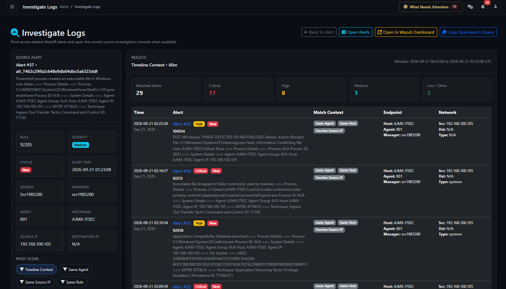

# Investigate Logs — analyst and client guide

Page: `/alerts/investigate_logs` with an existing alert reference. Applies to AlistoIR Community 3.0.3. Open **Investigate Logs** or an IP's **Logs** shortcut from [Alert View](ALERT_VIEW.md).

## What does this page do?

Investigate Logs is a **local alert-correlation workspace**. Starting from one alert, it finds other accessible alerts already ingested into AlistoIR that match selected context and received-time boundaries. It also provides a shortcut/query for continuing the investigation in Wazuh Dashboard where configured.

It helps answer: **What other detections occurred around this alert, and which share its endpoint, network addresses or rule?** A matching record is an investigative lead, not proof of the same attack or root cause.

| Workflow | Purpose |
|---|---|
| Investigate Logs | Search related records already stored in AlistoIR and open external console shortcuts. |
| Collect Wazuh Evidence and Analyze with AI | Separate Indexer collection and AI-report workflow. |
| Endpoint Investigation | Separate collection from the endpoint through a supported collector. |
| Investigation Center | Track autonomous collection, evidence readiness and analyst review. |

Opening Investigate Logs does not itself collect new endpoint data, run AI analysis, create a case, update disposition or execute containment. This page does not directly search the Indexer; the external console shortcut is a separate browser destination.

## 1. Open the correct source alert

Use the action inside an existing alert. The page accepts its AlistoIR reference (`alert_ref`) or internal Alert ID (`id`). A Wazuh Rule ID is not a unique alert identifier. Missing, invalid or inaccessible records can return Invalid alert or Alert not found.

The source alert is shown on the left. It is excluded from the related-result table and counts, so zero related results does not mean the source alert disappeared.

## 2. Navigation and tools

| Control | Behavior |
|---|---|
| Back To Alert | Returns to the original source alert. |
| Open Alerts | Opens the general alert list, not necessarily the same correlation scope. |
| Open In Wazuh Dashboard | Opens the configured/derived external Discover console with generated query/time context. Separate Wazuh authentication and permissions apply. |
| Dashboard Not Configured | No usable dashboard shortcut was resolved. An administrator should check its URL, route and configuration. |
| Copy OpenSearch Query | Copies the generated field-query text; it neither executes the query nor copies a complete time-filter state. |
| External Investigation Tools | Additional available console links and the same query-copy shortcut. |

A shared template can refer to other SIEM source consoles or No Source Link. This does not add other SIEM ingestion support to Community, which remains Wazuh-only.

## 3. Source Alert panel

| Field | Meaning |
|---|---|
| Alert number / reference | The record anchoring this investigation. |
| Description / Rule | Original detection description and rule identifier. |
| Severity / Status | Recorded alert priority and workflow state, not an AI verdict. |
| Alert Time | The stored received/created time used as the primary window center. |
| Source / Manager | Source classification and Wazuh manager context where available. |
| Agent / Hostname | Endpoint identifiers available for pivots. |
| Source IP / Destination IP | Addresses available for network pivots. N/A means no usable value was available. |

Check these identifiers before interpreting results. Similar names, shared addresses or generic rules can correlate unrelated activity.

## 4. Pivot Scope

Select a chip to change which relationship is required. Available chips depend on whether the source alert has the corresponding field.

| Scope | Local AlistoIR matching behavior |
|---|---|
| Timeline Context | Matches any available anchor: same agent, same host, either source-alert IP appearing as source or destination, or the same Rule ID. These are OR conditions, not a requirement to match everything. |
| Same Agent | Same recorded agent ID as the source alert. |
| Same Source IP | Candidate's source-IP field equals the source alert's source IP. |
| Same Destination IP | Candidate's destination-IP field equals the source alert's destination IP. |
| Same Rule | Same Rule ID, potentially across different hosts. |
| Same Host | Same recorded hostname. |

Every pivot also applies the selected received-time range and account access scope. For Wazuh alerts with a manager name, the local query additionally requires the matching manager context.

**Timeline Context is broader than a same-endpoint timeline.** An alert can appear only because it shares the rule or touches an IP. Read Match Context before assuming a causal chain. When no usable anchor exists, the fallback can effectively be a time-window correlation within the remaining scope, so treat it cautiously.

Missing-field scopes are normally hidden. An invalid/unavailable scope can fall back to Timeline Context; verify the active chip and Results heading after navigation.

## 5. Time Window — both before and after

The window is centered primarily on the source alert's **received/created time**, falling back to event time if creation time is unavailable. Local results are filtered by their received/created timestamps, not their original event timestamps.

| Chip | Range around the center | Total span |
|---|---|---|
| 15 Minutes | 15 minutes before through 15 minutes after | 30 minutes |
| 1 Hour | One hour before through one hour after | Two hours |
| 6 Hours | Six hours before through six hours after | 12 hours |
| 24 Hours | 24 hours before through 24 hours after | 48 hours |

The default is **1 Hour** (`60m`), unless the incoming link selects another allowed window. The Results header displays the actual **from/to UTC** range: use those boundaries rather than assuming the chip means a one-sided lookback or total duration.

Changing a scope keeps the selected window; changing a window keeps the selected scope. A delayed-forwarded alert can have an event time well outside this received-time-centered range. Compare Event Time and Received At in Alert View when investigating ingestion delays.

## 6. Results and summary counts

| Counter | Meaning |
|---|---|
| Matched Alerts | Number of returned related records, excluding the source alert. |
| Critical / High / Medium | Returned records in those severity categories. |
| Low / Other | Returned Low records plus missing/unrecognized severity classifications grouped into this summary bucket. It does not prove all are low risk. |

**Results are limited to the latest 200 matching records**, ordered by received time descending, then record ID descending. The counters summarize that returned set, not necessarily every possible match. There is no pagination control here to retrieve every remaining record.

If the result reaches 200, narrow the scope/window and investigate additional context through the full alert list or Wazuh console. Widening the window can increase omissions at the cap rather than providing an exhaustive timeline.

## 7. Result-table columns

| Column | Contents and interpretation |
|---|---|
| Time | Candidate received/created timestamp and relative age. Newest records appear first, not a forward chronological attack sequence. |
| Alert | Record link, severity/status badges, Rule ID and description. Open the link to verify original evidence. |
| Match Context | One or more relationship labels. These explain shared attributes, not causality. |
| Endpoint | Recorded Host, Agent and Manager. Missing fields remain limitations. |
| Network | Recorded Src, Dst and event Type. Address reuse can correlate unrelated activity. |

### Match Context labels

| Label | What it means |
|---|---|
| Same Agent | Candidate agent ID equals the source alert's agent ID. |
| Same Host | Recorded hostnames match. |
| Touches Source IP | The source alert's source IP appears in the candidate's source or destination field. |
| Touches Destination IP | The source alert's destination IP appears in the candidate's source or destination field. |
| Same Rule | Rule identifiers match. |
| Time-window match | No listed relationship badge was derived for that returned record; inspect the selected/fallback scope. |

Badges can overlap. A Touches Source IP badge is broader than the strict local Same Source IP pivot: a match label can describe an additional relationship beyond the selected search condition.

## 8. Color coding on this page

### Severity

| Severity | Color |
|---|---|
| Critical | Red |
| High | Yellow / warning |
| Medium | Cyan / information |
| Low | Green |
| Unknown / other | Gray |

### Alert status

| Status | Color |
|---|---|
| New | Red |
| Escalated | Yellow / warning |
| Investigating | Cyan / information |
| Reviewed | Gray |
| Resolved | Green |
| Dismissed | Dark |

This page's status/severity palette differs from some other AlistoIR views. Always read the written label. Red New means a workflow state, not a confirmed malicious verdict; green Resolved does not independently verify remediation.

## 9. Wazuh Dashboard and OpenSearch query

The shortcut builds a field query from available manager, agent, host, network and rule context, and supplies the selected UTC time bounds to the external Discover view. Whether the destination opens correctly depends on the configured base/path, index pattern, browser access, authentication and field mappings.

**Copy OpenSearch Query** copies the field-query string only. If pasting manually into Wazuh Dashboard, set the matching time range separately and verify the query language/index pattern. Query Copied confirms clipboard success, not a completed search. Copy Failed can reflect browser clipboard permissions or secure-context restrictions.

External matching need not produce identical counts to the local table. The generated query uses alternative field names; some network clauses can match opposite-direction address fields. Wazuh searches original indexed timestamps/data, while the local list uses AlistoIR received records, its access scope and a 200-record cap. Data retention, ingestion coverage and permissions can also differ.

A working dashboard link does not prove the AlistoIR Indexer integration or endpoint collector is healthy. A disabled link does not prevent the local correlation query from working.

## 10. Example workflow

This is an illustrative investigation, not a live detection result.

1. Open a suspicious authentication alert and select **Investigate Logs**.
2. Verify the reference host/agent, manager and received/event time.
3. Begin with **Timeline Context** and a narrow window to see related leads.
4. Use **Same Agent** or **Same Host** to focus on endpoint activity.
5. Use **Same Source IP** to inspect other alerts attributed to that source field, or **Same Rule** to examine rule recurrence.
6. Read each Match Context label and open relevant alerts. Compare original event timestamps before constructing a sequence.
7. Narrow results if capped; use Wazuh Dashboard for additional authorized searches when available.
8. Record verified findings, evidence gaps and references in the alert/case. Use the separate collection/AI workflows if more evidence is needed.

Repeated failures followed by an apparent success are a lead for validation, not proof that the same actor gained unauthorized access. Verify accounts, target, event semantics and timing in the original records.

## 11. Troubleshooting and interpretation limits

| Symptom | What to check |
|---|---|
| Invalid alert / Alert not found | Open from an accessible alert; use its internal ID/reference, not the Rule ID. |
| No related alerts matched | Verify selected pivot, available identifiers, manager, time bounds, access scope and ingestion coverage. Absence does not establish benign behavior. |
| A chip is missing | The corresponding source field may be absent. Inspect Raw JSON and extracted alert fields. |
| Exactly 200 results | The result cap may have been reached; narrow scope/time. |
| Results seem unrelated | Timeline Context uses OR matching and can include same-rule matches across hosts. Inspect Match Context or choose a narrower pivot. |
| Events appear out of order | Results are newest received-time first. Compare original event times for chronology. |
| Wazuh count differs | Check indexed versus received times, query field mappings, direction, scope, retention and local result cap. |
| Dashboard Not Configured | Ask the administrator to verify the Wazuh Dashboard URL/path and manager mapping. |
| Copy Failed | Check browser clipboard permissions/HTTPS context. Do not paste query context into a public issue. |

This is a snapshot loaded for the selected scope/window; the page has no investigation-worker progress timer or automatic collection control. Refresh or select a pivot to rerun the local view. Operational/query failures also need administrator review; an empty table alone cannot prove complete search coverage.

Queries and console URLs can contain internal hosts, IPs and detection context. Copying a query or following a console link does not apply the external-AI sanitizer. Share only sanitized references through approved channels.

Continue with [Alert View](ALERT_VIEW.md), [Alerts](ALERTS.md), [Investigation Center](INVESTIGATION_CENTER.md), [Wazuh setup](../docs/WAZUH_SETUP.md) or [Troubleshooting](../docs/TROUBLESHOOTING.md).

For the separate Indexer collection/report workflow, read [Collect Wazuh Evidence and Analyze with AI](WAZUH_AI_INVESTIGATION.md).
