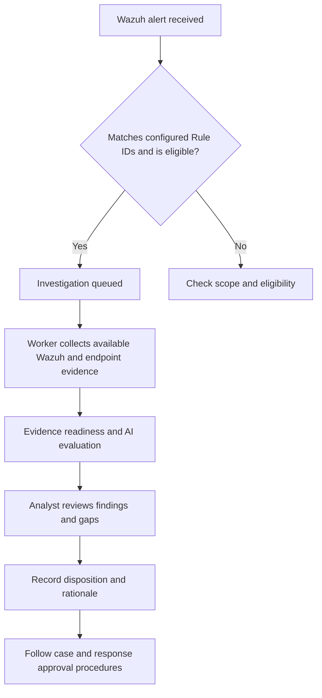

# Investigation Center — analyst and client guide

Applies to AlistoIR Community 3.0.3. Some controls depend on your role, access scope and integration configuration.

## What is the Investigation Center?

The Investigation Center is the workspace for tracking automated security investigations and reviewing their results. It brings together the alert, evidence collection progress, AI recommendation, missing evidence and the analyst's recorded decision.

For an analyst, it answers: **What happened, what evidence was collected, what is still missing, and what should I do next?**

For a client, it shows the progress and outcome of an investigation without requiring them to interpret every underlying security log. Visibility is limited by the signed-in account's permissions and agent-group scope.

An alert is the original security signal. An investigation is the work performed to assess that signal. A case groups related incident work, tasks and follow-up. They are connected records with different purposes.

## How the workflow works

This diagram describes the workflow, not a promise that every collection source is available. Integration failures, unsupported checks, time limits and missing telemetry can prevent a complete assessment. Adaptive planning also depends on its separate enabled state and configured safeguards.

**Keep these three results separate:**

| Result | Question it answers | Example |
|---|---|---|
| Collection status | Where is the investigation workflow? | Collecting or Completed |
| AI recommendation | What does the available evidence suggest? | A suspicious activity assessment with supporting reasons |
| Analyst decision | What conclusion did a person record after review? | True positive, False positive, Benign or Needs investigation |

**Completed collection does not mean an alert is benign, resolved or approved for closure.**

## Open the workspace

1. Sign in to AlistoIR.
2. Open **Investigation Center** from the navigation, or visit `/investigations/index` on your AlistoIR server.
3. Review the collection and adaptive-planning indicators at the top.
4. Select a summary card or use the State and search filters.
5. Open an investigation using its `INV-...` link.

A System Administrator can open **Autonomous investigation settings**. An analyst does not need to edit those settings simply to review an existing investigation.

### Understand the summary cards

| Card | Meaning |
|---|---|
| In progress | Investigations that are queued, collecting or evaluating. |
| Needs analyst review | Finished or blocked investigations without a final True positive, False positive or Benign analyst disposition. |
| Analyst reviewed | Investigations with a recorded True positive, False positive or Benign disposition. |
| Total investigations | Investigations visible within your account's scope. |

A **Needs investigation** disposition records follow-up work; it does not count as a final reviewed outcome for these filters. Cancelled investigations are excluded from the Needs analyst review view.

### Understand the investigation list

| Column | How to read it |
|---|---|
| Investigation | Investigation reference and the alert description. Select the reference to open details. |
| Host / scenario | The affected host and the investigation scenario. An unknown host needs further context. |
| Collection | Workflow status and the number of completed checks compared with total checks. |
| AI recommendation | The currently available AI verdict, or Awaiting evidence when none is available. |
| Analyst decision | The latest recorded human disposition, or Not reviewed. |

Search matches the host or alert description. Use **All** and clear the search when checking whether a record exists. An empty filtered view does not prove there are no alerts.

## Investigation statuses

| Status | Meaning | What the analyst should do |
|---|---|---|
| Queued | Registered and waiting for worker processing. | Check that collection is enabled for the rule. Allow for scheduler, load and budget delays. |
| Collecting | Evidence checks are being dispatched, processed or polled. | Monitor returned evidence and failed or unavailable checks. |
| Evaluating | Collected findings are being assessed and the result is being prepared or published. | Wait for completion; investigate repeated provider or publication failures with an administrator. |
| Completed | The workflow finished without recorded blocking collection gaps. | Read the evidence and AI reasoning, then record your own disposition. |
| Inconclusive | Evidence is insufficient for the required assessment. | Read the gaps and arrange the missing collection or manual verification. |
| Blocked | A problem prevents the workflow from completing. | Read the specific error or gap and ask the administrator to fix the relevant dependency. |
| Cancelled | Further automatic work was stopped, for example by an analyst or a change in alert disposition. | Read the reason and review already-collected evidence. Previously dispatched read-only tasks may still finish. |

Individual checks can have their own states, including unavailable or timed out. A failed check is a collection result, not proof that the endpoint is clean.

The worker is normally scheduled every minute. This is a scheduling interval, not a guaranteed investigation completion time. Paused collection or a rule excluded by settings can leave work waiting.

## Start an investigation for an existing alert

1. Open **Browse alerts** and locate the alert you want to investigate.
2. Note its internal **AlistoIR Alert ID**. This is different from the Wazuh Rule ID and the `INV-...` investigation reference.
3. Return to Investigation Center and select **Investigate an existing alert**.
4. Enter the Alert ID in the dialog and select **Start investigation**.
5. Open the resulting investigation and monitor its progress.

The alert must be visible to your account and eligible for collection. The dialog instructs you to use an alert that is still new. Starting manually does not bypass disabled collection, configured Rule IDs, access controls or other eligibility checks.

Administrators configure Rule IDs under `/investigations/settings`: `0` by itself selects all rules; specific numeric IDs restrict automatic scope. Do not mix `0` with other IDs. Selecting all rules does not make unavailable telemetry or unsupported collection techniques available.

## Read the investigation details

### AI recommendation

Read the recommendation, summary, suggested next action and update time. The displayed confidence is a **model confidence estimate**, not a measured probability that the conclusion is correct. Open the original alert to compare the recommendation with the underlying event and local evidence.

If collection is still active, avoid treating an existing cached recommendation as the final result of the current run. Check its timestamp and current evidence before deciding.

### Evidence gaps and decision readiness

Review **Evidence gaps**, **Decision readiness**, and **Missing evidence and next collection steps**. Distinguish a confirmed negative result from a check that was not run or could not return data.

For example, an unavailable process-tree check does not establish that no suspicious parent process existed. An Indexer search failure does not establish that no related events occurred. Follow the recorded gap to the specific source or check that needs attention.

The completed-check counter measures progress. It is not an evidence-quality percentage or a verdict-accuracy score.

### MITRE investigation coverage

The panel can show MITRE ATT&CK techniques and the checks available for those techniques. This helps explain why evidence was requested. A technique mapping describes investigation context; it does not prove that the attack occurred. A baseline-only or unsupported mapping indicates a coverage limitation to consider in your review.

### Historical context

If historical or similar-alert information is included, compare its evidence and resolution with the current event. A previous false positive is context, not permission to automatically dismiss a new alert with similar characteristics.

## Record the analyst decision

For an account with review permission, **Analyst review** becomes available when the investigation is no longer queued, collecting or evaluating.

1. Verify the original alert, evidence, time range and affected host.
2. Check unresolved gaps and the reasons behind the AI recommendation.
3. Choose a disposition.
4. Write the evidence and rationale, including any remaining uncertainty.
5. Select **Record analyst decision**.
6. Confirm the entry appears in **Review history**.

| Disposition | Practical interpretation |
|---|---|
| True positive | Evidence supports a genuine security detection that requires the appropriate incident or response workflow. |
| False positive | The alert does not correctly represent the suspected security condition; explain the evidence and why it was misleading. |
| Benign | The observed activity occurred but is verified as authorized or expected; document the verification. |
| Needs investigation | The available information is insufficient for a defensible final disposition; record what must happen next. |

The rationale must contain 10–4,000 characters. Useful notes identify the supporting evidence, any authorization verified, unresolved gaps and follow-up owner or action. Do not rely on the confidence score alone.

**Recording a review does not execute response actions or close a linked case.** Follow your case-management and response-approval procedures separately. The AI recommendation and human disposition remain separate records.

For an active investigation, an authorized analyst can use **Stop further collection** with a reason. Already-dispatched read-only tasks may still finish. Stopping collection records a Needs investigation review; it is not a False positive decision.

## Example: suspicious PowerShell activity

This is a fictional training example, not a live alert or a detection test result.

An alert reports suspicious PowerShell usage. The analyst opens its investigation, checks the affected host and event time, and reviews available command, process and related-event evidence.

- If authorized administrative activity is verified and the evidence supports that explanation, **Benign** may be appropriate.
- If the suspected condition was incorrectly detected, **False positive** may be appropriate, with the detection problem documented.
- If evidence supports malicious or unauthorized activity, **True positive** may be appropriate, followed by the approved case and response workflow.
- If essential command or process evidence is unavailable, record **Needs investigation** and specify the collection or verification still required.

The same alert description can lead to different decisions. The evidence and verification determine the outcome.

## AI privacy in 3.0.3

Outbound AI requests use the shared privacy sanitizer. Recognized secrets are withheld, recognized identities and network values receive aliases, and identified raw-log or note fields may be withheld. Evidence references remain available so analysts can inspect original records locally.

An alias is not an actionable endpoint address or IOC. Privacy-related omissions can limit the AI assessment and should be treated as evidence gaps. The sanitizer cannot guarantee recognition of every sensitive detail in arbitrary text. Read the [AI privacy guide](../docs/AI_PRIVACY.md) before using an external provider with client evidence.

## Common questions

| Question or symptom | Next step |
|---|---|
| No investigations match this view | Select All, clear search, verify account scope, then confirm that alerts exist and match the enabled collection rules. Older alerts may need a manual start. |
| Alert not found | Use an existing internal AlistoIR Alert ID, not a Wazuh Rule ID. Verify that the alert is not deleted or outside your access scope. |
| Queued for longer than expected | Ask an administrator to check collection settings, rule scope, scheduler, budgets and worker health. |
| Inconclusive | Read the exact missing-evidence requirements; do not convert missing telemetry into a benign conclusion. |
| AI request blocked or provider unavailable | Have an administrator inspect privacy, provider, quota and connectivity errors. Do not disable privacy or integrity controls to force a result. |
| No review controls | Check account permissions and whether the investigation is still active. |
| Review recorded but case remains open | Expected: investigation review does not close a linked case. |

For infrastructure checks, use [Troubleshooting](../docs/TROUBLESHOOTING.md). For configuration, use [Configuration](../docs/CONFIGURATION.md) and [Wazuh setup](../docs/WAZUH_SETUP.md).

## Analyst handover checklist

- Investigation and alert references are recorded.
- Host, event time and collection scope were checked.
- Evidence supports the conclusion; missing checks remain explicit.
- AI reasoning was reviewed against the original evidence.
- A disposition and rationale were recorded, or follow-up work was assigned.
- Case updates and response approvals were handled through the appropriate workflow.

For clients, report the investigation state, supported conclusion, remaining gaps and next action. Avoid describing an AI recommendation as a confirmed incident until the evidence and analyst review support it.
