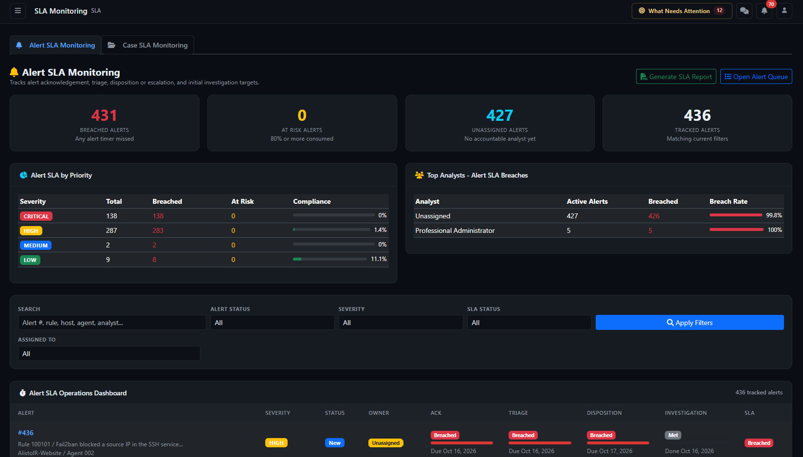

# SLA Monitoring — analyst and manager guide

Page: `/sla/index`. Applies to AlistoIR Community 3.0.3. Sign-in, access scope and applicable deployment feature permissions determine availability.

SLA means **Service Level Agreement**: the configured time targets for handling an alert or case. This workspace helps the SOC identify overdue work, approaching deadlines and missing ownership. It has two tabs: **Alert SLA** (the default) and **Case SLA**.

An SLA status describes timeliness, not whether activity is malicious. A completed autonomous investigation does not automatically mean that every analyst responsibility is complete. This page monitors stored milestones and targets; it does not itself assign work, investigate endpoints, dismiss alerts or close cases.

## 1. How to use it

1. Open **SLA**, then choose Alert SLA or Case SLA.
2. Start with Breached and At Risk items; check owner and business/detection priority.
3. Apply the appropriate search, lifecycle, severity/priority, SLA and analyst filters.
4. Open the alert or case to inspect evidence and perform the actual permitted workflow action.
5. Verify that the appropriate milestone was recorded. Refresh the dashboard to see updated calculations.
6. Review unassigned and missing-target records separately, then use Generate SLA Report for period reporting.

For example, an alert with Ack completed but Triage breached needs triage follow-up even if its AI verdict is already available. A case with Resolution On Track can still have a missed Response target: inspect both timer columns.

## 2. Status labels and colors

| Status | Meaning on this dashboard | Color |
|---|---|---|
| Breached | A measured deadline has been exceeded or a relevant breach flag is recorded, subject to the timer rules below. | Red |
| At Risk | About 80% or more of the timer budget is consumed, without a current breach. | Yellow |
| On Track | Configured target exists and the applicable timer has not reached the warning/breach state. | Green |
| Met | Completion condition is present according to that timer's implementation. Review historical lateness separately. | Gray |
| Not Set | No usable target/deadline is available. This is not a successful result. | Gray |

Progress percentages are rounded and capped at 100%; 100% does not show how far overdue an item is. At Risk uses that rounded percentage, so the warning boundary is approximate. Remaining duration and risk of compromise are different concepts.

Values are computed when the page loads. There is no continuously ticking/live auto-refresh loop on this screen. Refresh after time passes or after changing an underlying record.

## 3. Alert SLA: four milestones

| Timer | Stored completion milestone | Interpretation |
|---|---|---|
| Ack | First acknowledged timestamp | Responsibility/acknowledgement was recorded. Merely reading a chat message is not an acknowledgement. |
| Triage | Triage started timestamp | Initial handling began; this is not proof that all triage work finished. |
| Disposition | Disposition completed, falling back to escalated timestamp | A disposition/escalation milestone exists. It does not prove a linked incident was resolved. |
| Investigation | Initial investigation completed timestamp | The application recorded the initial-investigation milestone. Review evidence coverage and analyst obligations in Alert View. |

Each timer uses its own due date, with elapsed progress measured from the alert SLA start timestamp (falling back to alert creation where applicable). Configured policy can affect due-date calculation. Do not assume every severity has the same target or that these four timers necessarily start sequentially.

For an incomplete timer, a passed deadline or recorded breach flag produces Breached. Without a breach, a consumed budget of roughly 80% produces At Risk. A missing due date produces Not Set.

### Completion does not prove an on-time result

The current alert dashboard marks a timer **Met whenever its completion timestamp exists**, even if it finished after the due time or a historical breach flag remains. The “Done” age is completion timing, not an on-time certification. To assess historical compliance, compare actual milestone and due timestamps and inspect the underlying tracking/report evidence.

Closing, dismissing or escalating an alert alone does not universally stop every timer in this dashboard. The display evaluates each milestone. Conversely, an automatic or workflow-driven completion timestamp is not by itself proof of sufficient investigation evidence.

### Overall Alert SLA

The row's overall SLA selects the highest-priority state among the four timers: **Breached → At Risk → On Track → Met → Not Set**.

This means a single incomplete overdue timer can make the alert Breached. It also means one Met timer with the remaining timers Not Set can yield overall Met; overall Met does not guarantee that every policy milestone was configured and completed.

## 4. Alert cards and summary panels

| Display | Meaning |
|---|---|
| Breached Alerts | Filtered loaded alerts whose overall SLA is Breached. |
| At Risk Alerts | Filtered loaded alerts whose overall SLA is At Risk. |
| Unassigned Alerts | Filtered loaded alerts without a resolved owner name. Check the alert if an owner ID exists but the user name is missing. |
| Tracked Alerts | Number of currently filtered, loaded alert SLA records. Not every ingested alert. |
| Alert SLA by Priority | Groups by **alert severity**, despite the Priority title. |
| Analyst SLA table | Active-alert workload by owner name, showing total, breached and breach rate; up to 10 groups. |
| Timer breach breakdown | Counts displayed breaches separately for acknowledgement, triage, disposition and initial investigation. |

An alert can contribute to several timer breach categories, so summing those categories can exceed Breached Alerts. Completed alert timers can disappear from displayed breach counts despite historical lateness.

“Compliance” in the severity summary is **(total − breached) / total × 100**. It includes items that are still On Track, At Risk or lack targets; it is not a completed-on-time percentage. Analyst breach rate is breached active alerts divided by active alerts in the shown group.

Active workload excludes alert statuses dismissed, escalated, resolved, closed and false_positive. Analyst grouping uses display names, so identical names can merge. This is a workload signal rather than a validated analyst performance score.

## 5. Alert filters and table

Search supports displayed alert ID, rule ID/description, source, hostname, agent ID and analyst name. It is a case-insensitive substring search across those values, not raw-event search or a general IP filter.

Use the provided Alert Status, Severity, SLA Status and Analyst selectors. The analyst control supports Unassigned. Filters combine, and Apply/Filter resets the alert table to its first page. Clear resets that tab's filtering. Tab navigation can preserve the other tab's query parameters.

| Column | Use |
|---|---|
| Alert | Alert reference, detection context and link to Alert View. |
| Severity / Status | Detection importance and alert lifecycle, separate from SLA state. |
| Owner | Recorded accountable analyst or missing-owner indication. |
| Ack / Triage / Disposition / Investigation | Per-milestone badge, progress bar and Done/Due relative time. |
| SLA | Combined state of those timers. |

Use **Open Alert Queue** for broader triage and open an alert to acknowledge, review evidence, disposition or escalate through authorized controls. SLA Monitoring has no bulk completion action.

### Alert coverage limit

The dashboard first loads up to **500 accessible, non-deleted alerts with SLA tracking records**, then applies alert filters in memory. Loading favors stored breach flags/statuses, then at-risk state, then new alerts, with creation time ordering inside those groups. It is not simply the newest 500 alerts or a complete all-time search.

The table paginates the filtered loaded set at **10 rows per page**. Pagination cannot recover records omitted by the initial 500-record limit. Cards, severity/analyst summaries and search all share this bounded population. An absent alert may lack tracking, be inaccessible or fall outside the loaded set; absence is not proof of compliance.

## 6. Case SLA: response and resolution

Case SLA tracks the broader case lifecycle after triage/escalation. The current dashboard specifically displays **Response SLA** and **Resolution SLA**, based on legacy case tracking duration fields. Do not assume separate assignment, investigation and containment timers are all visible in this table.

| Timer | Current calculation |
|---|---|
| Response | Uses a non-zero stored time_to_respond; otherwise elapsed time from case creation to closure for a closed case, or to now. |
| Resolution | Uses a non-zero stored time_to_resolve; otherwise elapsed time from creation to closure for a closed case, or to now. |

The close timestamp prefers closed_at, then resolved_at. If a closed case has neither a usable stored duration nor a usable close timestamp, fallback elapsed time can continue to now. Verify missing timestamps instead of treating the displayed duration as a confirmed measurement. A true zero duration also falls through this fallback logic.

A target must be positive to be usable. A recorded breach flag or elapsed duration **greater than** the target produces a breach. The main Case SLA status is the **Resolution** state, not the worst of response and resolution:

- No resolution target: Not Set.
- Resolution breached: Breached, including a closed case that exceeded its target.
- Closed/false_positive case within the resolution target: Met.
- Open case near the resolution target: At Risk.
- Otherwise: On Track.

Case Response does not use a special completed/Met state in this dashboard. Its progress bar can remain yellow for a completed response that consumed most of its budget. Open the case to interpret the milestone rather than inferring from color alone.

These dashboard fallback calculations use elapsed wall time from creation; they do not independently recalculate business-hours calendars. Where a policy uses business hours or newer milestone tracking, verify the policy, case view and period report before reconciling numbers.

## 7. Case cards, priority and analyst summaries

| Display | Meaning |
|---|---|
| Breached SLA | Filtered cases with Resolution state Breached; the percentage uses all currently filtered cases. |
| At Risk | Filtered cases with Resolution state At Risk. |
| SLA Met | Filtered closed/false_positive cases meeting the resolution-state rules. |
| Total Cases | All cases matching current case filters, including states without a usable target. |
| SLA by Priority | Grouped by P1/P2/P3/P4 where recorded, with total, resolution breaches, at risk and compliance. |
| Analyst summary | Up to 10 owner-name groups of active cases, sorted by breach count then workload. |

Case compliance is also **(total − breached) / total × 100**, rather than completed-on-time cases divided by completed cases. Response-only breaches do not reduce this resolution-based number. Active analyst counts omit closed and false_positive cases; those records can still appear in overall summaries.

Case summaries follow the current filters and include all filtered rows before pagination, not only the 10 displayed rows. A closed case can remain Breached; closing it does not erase the recorded missed resolution target.

## 8. Case filters and table

Use case-number/title search, Status, Priority, breach/status and Analyst filters. The breach selector can distinguish Breached, At Risk, Response Breached, Resolution Breached and Met where offered. Response Breached evaluates the response state; the main Breached filter evaluates resolution. Search uses partial matching, not arbitrary query syntax.

The table includes Case #, Title, Priority, Status, Created, Closed Date, Response SLA, Resolution SLA, SLA Status and Assigned To, plus a View action. Duration columns show **elapsed/recorded hours versus target hours**. Rounding to one decimal can hide small differences; a dash can represent missing or zero duration/target.

The resolution badge can show overdue hours. Rows sort by Resolution SLA state (Breached, At Risk, On Track, Met, Not Set), then priority and older creation time. Pagination shows 10 cases per page. Unlike alerts, this case-dashboard query has no initial 500-row cap.

Open a case to investigate, assign ownership, update its lifecycle or record resolution. This screen does not provide a policy editor, pause button, target extension, evidence collector or automatic remediation control. Pending status does not itself pause these elapsed-time calculations.

## 9. Generate an SLA report

1. Select **Generate SLA Report** from either tab.
2. The link opens the separate report page with **combined** scope and a **monthly** period; it does not export the dashboard's current filters or current page.
3. Choose the report type (alert/case/combined), reporting period and relevant date controls on that page.
4. Review classification, displayed period/timezone, report details and methodology.
5. Use **PDF Report** or **Print / Save PDF**, then inspect the resulting artifact before sharing.

Report periods include Monthly, Quarterly, Yearly and Date Range. This is a distinct reporting workflow with its own queries, milestone definitions and time boundaries. Its results need not equal this bounded alert dashboard or the legacy case response/resolution calculations. Compare the same cohort and timestamps before treating differences as defects.

The report summarizes timeliness, not malicious verdict accuracy. Generated PDFs and printed pages can contain private SOC evidence and identities; review recipients and content. AI outbound sanitization does not automatically sanitize local reports. See [Reports](REPORTS.md) for general reporting guidance.

## 10. Autonomous investigation and analyst responsibility

The **Investigation** column is an SLA milestone, not the Autonomous Investigation worker status. Queued, collecting, completed or inconclusive describe investigation execution/evidence outcomes; they are not interchangeable with On Track, Met or Breached.

An AI report can arrive while acknowledgement, triage or disposition still needs action. Likewise, a timer can be completed while evidence is insufficient for a final verdict. Use the original alert's evidence, investigation status, missing-data indicators and analyst decision controls. Escalation transfers the main lifecycle focus to Case SLA, but verify remaining alert milestones instead of assuming every timer stopped.

See [Alert View](ALERT_VIEW.md), [Investigation Center](INVESTIGATION_CENTER.md) and [Autonomous Investigation Settings](INVESTIGATION_SETTINGS.md).

## 11. Troubleshooting and daily review

| Symptom | What to check |
|---|---|
| Alert is missing | Tracking existence, access scope, filters and the initial 500-record bound; use the alert queue for the original record. |
| Alert tab is unexpectedly empty | Tracking/schema availability and server logs as well as filters. A load failure can appear as no rows; it is not a clean compliance result. |
| Met but completed late | Current alert timer display prioritizes completion; compare completion timestamp with due timestamp and historical flags. |
| Case On Track but response missed | Main case SLA badge is resolution-based; inspect Response SLA/filter separately. |
| Closed case still Breached | Expected when resolution exceeded its target or a breach flag persists. |
| Closed case duration keeps increasing | Missing stored duration/closure timestamps can trigger fallback to now. |
| At Risk slightly before 80% | Percentage rounding affects the displayed threshold. |
| Compliance looks too high | Non-breached active and missing-target records are included; this is not a validated completed-on-time percentage. |
| Unassigned card/filter disagree | Card uses missing owner name; filter uses owner ID. Inspect deleted/missing user references. |
| Analyst totals appear merged | Grouping uses displayed names, not distinct user IDs. |
| Report and dashboard disagree | Check period, access, bounded alert population, current versus stored breach state, completion rules and legacy/newer tracking definitions. |
| Timers look stale | Refresh the page, then verify policy, worker/milestone updates, timestamps and server clock. |
| Not Set | Check policy applicability, positive targets/due dates and tracking creation; do not mark the work complete just to clear the label. |
| Feature unavailable | Check account scope and deployment permissions with the administrator. |

During handover, record the affected alert/case reference, missed milestone, owner, next action and coverage gap. Prioritize actual deadlines and business impact; do not change verdicts, erase tracking or close unsupported findings merely to improve SLA colors.
