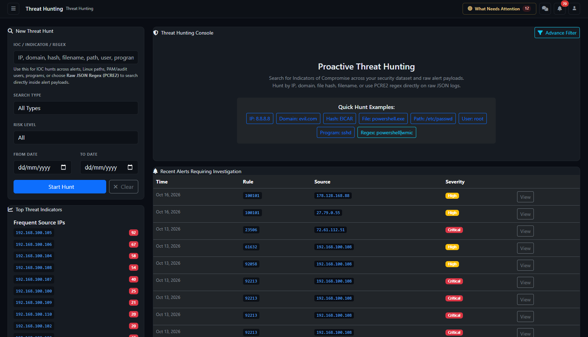

# Threat Hunting — complete analyst guide



Page: `/hunt/index` (also `/hunt`). Applies to AlistoIR Community 3.0.3. Access requires an eligible analyst/manager role and the applicable deployment permissions/features.

## What does Threat Hunting do?

Threat Hunting searches **alert records already stored in AlistoIR**, including supported extracted event fields and linked artifact values. It helps an analyst look for a known observable, process, account, path or pattern across accessible records.

It is not a live endpoint scan, an unrestricted Wazuh Indexer search or automatic AI analysis. Displayed risk, AI and IOC badges are existing stored context; running a hunt does not regenerate them.

| Related workflow | Difference |
|---|---|
| [Alerts](ALERTS.md) | General alert listing and triage filters. |
| [Investigate Logs](INVESTIGATE_LOGS.md) | Correlation anchored to one alert and a surrounding time window. |
| [Wazuh evidence and AI report](WAZUH_AI_INVESTIGATION.md) | Separate Indexer collection and model-assessment workflow. |
| [Threat Intelligence Hub](THREAT_INTELLIGENCE.md) | Manages intelligence objects, feeds and trust exceptions. |
| This hunt page | Searches retained local alert context and records a hunt workflow/history entry where available. |

A matching string is an investigative lead, not a confirmed attack or a shared root cause. No match does not establish absence of activity.

## 1. Search controls

| Field / control | Purpose |
|---|---|
| IOC / Indicator / Regex | Required search term or PCRE2 pattern. It need not already exist in the IOC feed library. |
| Search Type | All Types, IP Address, Domain, File Hash, Filename/Path, User / Account, Program / Process, Path or Raw JSON Regex (PCRE2). |
| Risk Level | All, Critical, High, Medium or Low. Despite the label, this filters the alert's **severity**, not a numeric risk-score threshold. |
| From Date / To Date | Optional inclusive calendar-date bounds on alert received/created timestamps. |
| Start Hunt | Runs the selected local search and records/reuses history where supported. |
| Clear | Returns to the blank/default hunt page; it does not delete alerts or hunt history. |

Filters combine. If both valid dates are reversed, they are normalized into order. One endpoint can act as an open-ended date restriction. No dates means no explicit search-date restriction, but result caps and retention still apply.

The date filter is based on stored received/created dates, not necessarily the original event time. Compare timestamps in Alert View when forwarding was delayed. Check deployment timezone/date handling when correlating with external reports.

The Hunting in progress message/loading state indicates a request in progress, not a continuous background scan. Avoid repeated submissions while it is loading.

## 2. Search Type behavior

| Type | Actual local search coverage |
|---|---|
| All Types | Source/destination IP, rule description, hostname, selected extracted path/user/program/PAM service context and linked artifact values where available. It is not every raw JSON field. |
| IP Address | Partial match against source and destination address fields. It is not an exact-address or CIDR search. |
| Domain | Rule description and linked artifact values where available. It does not guarantee a complete DNS-log search. |
| File Hash | Linked artifact values. If suitable artifact relationships/tables are unavailable, this mode cannot find those values through this path. |
| Filename/Path | Rule description, selected extracted path/program context and linked artifact values where available. |
| User / Account | Selected extracted observed-user and PAM service fields. It is not SOC owner/assignee search. |
| Program / Process | Selected program/process context and rule description. |
| Path | Selected extracted path fields and rule description. |
| Raw JSON Regex (PCRE2) | A bounded scan of serialized alert payload text using a validated pattern. |

Standard modes use partial matching. For example, a short IP fragment can match a longer address, and an observable can appear in explanatory text rather than an executed command. Open the original alert to verify where and why it matched.

Field extraction depends on supported payload layouts, including selected Linux PAM/audit/osquery/path context. A visible value elsewhere in a raw payload is not guaranteed searchable through every structured mode. Use a narrow regex search if appropriate rather than assuming every field was indexed here.

## 3. Raw JSON Regex (PCRE2)

Regex mode accepts a PCRE2-compatible expression, with an input limit of **300 characters**. Invalid expressions are rejected. Undelimited patterns are wrapped with case-insensitive, multiline and Unicode flags; explicitly delimited patterns can supply supported flags.

Illustrative example:

```text
powershell\.exe|wmic\.exe
```

This looks for either program string in serialized payload text. A match does not prove that the program executed maliciously. JSON escaping, capitalization/flags, event layout and truncated candidate coverage can affect results.

The page reads up to **750 newest candidate rows** matching severity/date/access scope, then returns at most **500 matches**. A short preview around the match can appear in the Rule column; it is not the entire event.

Use dates and scope to narrow the candidate set. Zero regex matches can mean the relevant record was outside the candidate limit. Regex runtime/resource failures can also limit interpretation; validate the expression and inspect errors instead of assuming a clean result. Regex here is text matching, not shell/script execution.

## 4. Top Threat Indicators sidebar

| Section | Meaning |
|---|---|
| Frequent Source IPs | Up to 10 source addresses ranked by scoped alert count. |
| Top Rules Triggered | Up to 10 rules ranked by scoped alert count. |
| Most Active Hosts | Up to eight hosts ranked by scoped alert count, with a quick-hunt shortcut. |

These use the accessible alert inventory, not necessarily the current hunt's search/date filters. The title does not mean every listed IP, rule or host is malicious. High counts can reflect noisy detections or legitimate busy systems.

Selecting a host shortcut populates a hunt using that host context. Check the resulting type/risk/date controls: quick actions need not reset all existing filters.

## 5. Hunt Summary

| Metric | Meaning |
|---|---|
| Total Matches | Returned result-row count, subject to caps; not necessarily all retained matches. |
| Critical | Returned rows whose recorded severity is Critical. |
| High | Returned rows whose recorded severity is High. |
| Unique IPs | Distinct non-empty source and destination values in the returned set. |
| Unique Hosts | Distinct non-empty recorded hostnames in the returned set. |

These describe the returned data, not unique incidents, attackers or verified infected endpoints. Case relationships can cause the same alert to appear with different linked-case rows, so a match count is not always a distinct-alert count.

## 6. Search limits and ordering

Normal searches return up to **500 result rows**, newest received/created time first. Regex mode has the separate **750-candidate / 500-match** limits above. There is no result-pagination control on this page for retrieving every omitted match.

Narrow the dates or choose a more specific term/type when results reach the cap. A larger date range is not automatically more complete if newer rows crowd out older candidates. Use the full alert/source-console workflows for additional authorized review.

## 7. Hunt Results table

| Column | Contents and how to use them |
|---|---|
| Severity | Recorded alert severity, with optional stored risk-score and AI badges. |
| Rule | Rule ID, shortened description, available MITRE, extracted Path/Program and regex-match preview. |
| Host | Recorded hostname or a missing-value marker. |
| Source IP | Recorded source address, with optional IOC badge and user/PAM context. |
| Destination | Recorded destination address or missing-value marker. |
| Case | Associated case link or Unlinked. Unlinked does not establish that no investigation occurred. |
| Time | Alert received/created time, not necessarily original event time. |
| View action | Opens the original alert for evidence, investigation and analyst decisions. |

A source IP is not automatically an attacker address; an observed user is not the assigned SOC analyst. A MITRE label describes mapped context, not confirmed execution. Check each original alert before connecting results into an attack narrative.

### Color coding

| Signal | Colors / meaning |
|---|---|
| Severity | Critical red; High yellow; Medium cyan/info; Low/unknown gray. |
| Stored risk score | 80+ red, 60–79 yellow, 30–59 gray, lower scores dark. This is prioritization, not probability. |
| AI badge | Red for malicious-text category, yellow for suspicious, green for benign, info for other text. Hover for stored verdict/confidence. |
| IOC badge | Red indicates a stored match with available confidence, not a new lookup performed by the hunt. |
| Hunt history state | Active yellow; Completed green. These concern the hunt record, not the endpoint's threat outcome. |

The page's severity palette differs from some other views. Always read the label. AI confidence, risk score, severity and IOC confidence are different metrics. A stored assessment can also be stale relative to newly collected evidence.

## 8. Previous Hunts and storage

A successful search can create or reuse an **Active** hunt record for the current user, same search value and type within its scope. Re-running that value/type can update its match count rather than create another record, even if risk/date filters changed.

Therefore, **Previous Hunts is not an immutable snapshot of every filter combination or result row**. Record exact term, mode, dates, limitations and evidence references in your analyst/case notes when needed. Rerunning a search reads current stored alerts; it does not guarantee the same result as a past run.

The list shows term/type, recorded time, hits, author and Active/Completed state. It is a bounded recent history view, not necessarily a clickable saved-query launcher or a full archive of all hunts.

If database history storage is unavailable, searching can still work while persistence is missing or session fallback is used. Read the storage warning; do not assume all history survives logout/browser changes or that search results were durably archived.

Hunt-record completion/deletion is permission-controlled: managers can manage eligible records, while ordinary users are restricted to their own records through the supported action path. Clearing the search is not deletion.

## 9. Mark Hunt Complete

When a current eligible hunt record and results are available, **Mark Hunt Complete** opens a dialog with optional Completion Notes. Verify the searched indicator and enter the findings, coverage limits and next actions, then select **Save and Complete**.

This records the hunt as Completed and appends completion context. It does not close a case, update every alert, certify no compromise, create intelligence entries or execute response. **Hunt Already Finalized** can indicate no active current record is available; follow the displayed state and storage messages before retrying.

The completion control is not offered in the same way for an empty result set. Do not invent a hit to enable it: document the negative search and its limitations through the appropriate case/analyst process.

## 10. Export CSV and Export JSON

Both exports download the **current bounded search results**, not a full alert database or all raw logs.

- **CSV:** Selected result columns including alert ID/rule, shortened description, severity, stored risk/AI/MITRE context, host/IPs, IOC context, case and received time. The description is shortened in this export.
- **JSON:** The current result objects and available projected fields, which can include regex-preview context. It is not guaranteed to contain the complete original payload.

Exports do not automatically apply the external-AI sanitizer. Review hostnames, addresses, user/event details and any regex excerpts before sharing. Validate column completeness and protect client data; exporting does not create a forensic chain of custody or save case evidence automatically.

## 11. Blank-page tools and recent alerts

Before entering a hunt term, the page can display **Proactive Threat Hunting**, Quick Hunt Examples, a link to the separate **Advanced Multi-Filter** workspace and up to 10 Recent Alerts.

Quick examples demonstrate input formats, not approved production blocklists or proof of an attack. Do not assume a familiar program, account or external example value is malicious. Replace examples with a verified investigation hypothesis.

**Advanced Multi-Filter** opens `/hunt/multi-filter`, a separate visual filtering workspace with its own conditions and limits. The main hunt page's field-match rules do not describe every advanced-builder option.

## 12. Suggested analyst workflow

1. Define the hypothesis and authorized host/time scope.
2. Choose the appropriate search type and a meaningful term.
3. Set dates and the intended severity filter; run once and inspect errors/limits.
4. Check where each string matched and distinguish case-linked duplicate rows.
5. Open original alerts, compare event versus received times and review related evidence.
6. Use separate endpoint/Indexer collection if the stored data is insufficient.
7. Record verified findings, gaps and references in the formal investigation/case.
8. Export reviewed bounded results if needed, then complete the hunt record where appropriate.

This is an analyst-led search, not an automatic AI verdict. A match can support further investigation; an absence can only describe what the selected search could observe.

## 13. Troubleshooting

| Symptom | What to check |
|---|---|
| Access/feature unavailable | Role, account/tenant context and deployment feature configuration; ask the administrator rather than editing protected code. |
| No matches | Dates, severity filter, search mode, supported extracted fields, artifact relationships, retention and result caps. |
| Hash visible in raw JSON but hash search misses it | Structured hash mode uses linked artifact values; review artifact extraction or a bounded raw-JSON search. |
| IP search returns similar addresses | It uses partial matching, not exact address/CIDR semantics. |
| Risk Level does not match numeric score | The filter compares alert severity, not risk_score. |
| Invalid PCRE2 pattern | Check syntax, escaping, delimiters/flags and the 300-character input limit. |
| 500 results or no old regex hits | Narrow filters; result/candidate caps may omit records. |
| Sidebar counts differ from summary | Sidebar rankings use a different population than the current filtered result set. |
| Previous Hunts empty | Review database-history permissions/schema/storage warning and account scope. |
| Same hunt entry changed | Active history can be reused for the same user/value/type despite different date/risk selections. |
| Completed hunt but open case remains | Expected: these are separate workflow records. |
| Security validation failed | Refresh the signed-in page before retrying a state-changing action. Do not disable CSRF/integrity controls. |

Continue with [Alerts](ALERTS.md), [Alert View](ALERT_VIEW.md), [Investigate Logs](INVESTIGATE_LOGS.md), [Investigation Center](INVESTIGATION_CENTER.md), [Threat Intelligence](THREAT_INTELLIGENCE.md) and [Troubleshooting](../docs/TROUBLESHOOTING.md).
