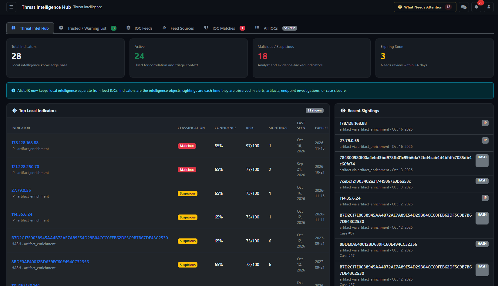

# Threat Intelligence Hub / IOC Manager — complete guide



Page: `/ioc/index` (also `/ioc`). Applies to AlistoIR Community 3.0.3. The management page requires a manager-capable account. Ordinary analysts can encounter intelligence context in alerts/cases without having access to every management control here.

## What is this page for?

The Threat Intelligence Hub manages observable knowledge, trusted exceptions and external feed indicators used during correlation/enrichment. IOC means **Indicator of Compromise**, but a saved indicator or match is an investigative lead, not proof that the current endpoint is compromised.

Three different data sets appear on this page:

| Data set | Purpose |
|---|---|
| Local intelligence indicators and sightings | AlistoIR's accumulated classifications, risk/confidence and observations from supported alert/artifact/endpoint/case workflows. |
| Trusted / Warning List | Explicit known-good exceptions used by supported enrichment paths. |
| Feed IOCs and feed-source configurations | Saved threat-feed values and the download/import configuration used to maintain them. |

A sighting is an observation, a match is a recorded correlation, and a feed source is a configuration. Their counts are not interchangeable.

## 1. Tabs and Community quota

| Tab | Contents |
|---|---|
| Threat Intel Hub | Local intelligence summary, top indicators and recent sightings. |
| Trusted / Warning List | Known-good exceptions, scope, rationale and revocation. |
| IOC Feeds | Saved feed rows grouped by scope/source/type. |
| Feed Sources | External download/import configurations and refresh status. |
| IOC Matches | Recent stored artifact-to-feed matches. |
| All IOCs | Searchable, paginated feed-indicator inventory and export. |

Community supports **3,000 active unique saved feed IOCs**. The usage banner concerns this feed library, not a combined count of every local-memory indicator, sighting, trusted entry or historical match.

- Active for this quota means **unexpired or no expiry**. Expired records do not consume active slots.
- Normalized duplicate type/value indicators share a quota slot. URL identity preserves case; other supported values are trimmed/lowercased in the Community upsert path.
- Private/global records remain separate for visibility even when the same indicator shares quota identity.
- Same-scope imports can update existing values rather than add duplicates; this does not guarantee all source labels/tags are replaced.
- At capacity, new active indicators are blocked/skipped with a message. Existing matching and external lookups remain available.
- Disabling a source does not expire/remove its saved IOCs or free their slots.

There is no separate per-feed-IOC Enable/Disable toggle on this page. Use supported expiry/maintenance or deliberate removal when appropriate; do not edit protected quota code. Visible counts can differ from quota usage because scope, duplicates and expired rows differ.

## 2. Scope and permissions

**Global** feeds/values are platform-managed and shared in applicable organization views. **Private / Organisation** entries belong to an organization scope. Platform administration can have broader visibility and management permission.

Locks and Read-only markers mean a control is unavailable to the current account, commonly for global data. Public/global describes application visibility, not anonymous Internet access.

Adding, refreshing, deleting or revoking is a real state change. Verify the scope before submitting, especially Global trust entries that can affect all organizations on the deployment. Export is a separate server path; administrators must verify its effective authorization/scope before using it for client data sharing.

## 3. Threat Intel Hub

| Summary card | Meaning |
|---|---|
| Total Indicators | Local intelligence objects in scope, not feed-library rows. |
| Active | Objects currently marked Active for correlation/triage context. |
| Malicious / Suspicious | Objects with those stored classifications; not a confirmed-incident count. |
| Expiring Soon | Active objects whose expiry falls on or before the next 14-day boundary. Stale overdue objects may also appear until lifecycle processing updates them. |

### Top Local Indicators

The view shows up to **25**, prioritized by recorded risk, confidence and recency.

| Column | Interpretation |
|---|---|
| Indicator | Value, type and local source. Select it to open details. |
| Classification | Malicious, Suspicious, Benign, False positive or Unknown context. |
| Confidence | Recorded assessment estimate, not a measured probability that the current alert is malicious. |
| Risk | Local 0–100 prioritization score, separate from confidence. |
| Sightings | Recorded observation count, not necessarily distinct attackers or incidents. |
| Last Seen | Latest stored observation, not proof of current activity. |
| Expires | Knowledge freshness/lifecycle boundary or No expiry. |

Classification colors: **Malicious red; Suspicious yellow; Benign/False positive green; Unknown gray**. They concern the intelligence object and must be checked against the current event.

### Recent Sightings and indicator details

The hub shows up to **20 recent sightings**. They describe where/when the observable was recorded, including supported alert, artifact, endpoint or case context. They do not prove a new independent compromise on every occurrence.

Opening an indicator shows its details, bounded Sightings, Lifecycle and Audit Trail. Use these to verify provenance, classification changes, expiry and supporting references. The detail lists are bounded recent views, not a complete forensic archive.

Local memory is built through supported enrichment and analyst/case workflows; it is not an unlimited raw-log repository. No local intelligence can mean those workflows have not populated it yet.

## 4. Trusted / Warning List

This is a **known-good exception list**, despite the word Warning. It can include internal services, validated scanners, update infrastructure or verified false-positive observables.

| Card | Meaning |
|---|---|
| Trusted Observables | Stored exception entries in scope. |
| Active Skips | Entries not revoked and eligible for supported enrichment skips. |
| Revoked | Exceptions withdrawn but retained for audit context. |

### Add Trusted Observable

| Field | Purpose |
|---|---|
| Type | IP, Domain, Hash, URL, Email, Process, Registry or Certificate. |
| Value | Exact observable to classify as trusted; verify normalization and specificity. |
| Category | Known Good, Internal Asset, Corporate Service, Security Scanner, Update Server, Approved Tool or False Positive. |
| Scope | Current organisation, or Global where your role permits it. |
| Reason | Evidence-based justification and verification context. |

Matching artifacts can be treated as trusted and skip supported external TI/AI enrichment paths. **This is not a master suppression of every alert, every AI workflow or all evidence collection.** It does not itself close a case, dismiss an alert or establish that every use of that observable is authorized.

Choose narrow exceptions and document why they are justified. A legitimate tool/domain can still participate in malicious activity. Do not add an entire category merely to hide inconvenient results.

### Review and revoke

The table shows Observable, Category, Scope, Added By, Status and the available Revoke action, with up to **200** rows displayed. Active trust appears green; revoked context is retained rather than treated as a newly trusted entry.

**Revoke** opens a confirmation with a reason field. It withdraws the exception through supported local/allowlist synchronization; it does not automatically declare the value malicious, rerun all historical analyses or undo past decisions. Review affected alerts and enrichment separately.

## 5. IOC Feeds

This tab groups saved feed records by **scope, Source Name and Type**.

| Column | Meaning |
|---|---|
| Source | Feed attribution plus Global/Private scope. |
| Type | Stored indicator type. |
| Count | Rows in that group; not necessarily active unique quota usage. |
| Max Confidence | Highest recorded confidence in the group, not its average or a guarantee of quality. |
| Last Seen | Most recent stored feed-observation/update time in the group. |
| Delete Source IOCs | Deletes saved rows for the selected source-name scope where permitted. Review the confirmation. |

A source name can span multiple types. **Delete Source IOCs can remove all applicable types under that source name**, not only the visible group row. It does not necessarily remove the external source configuration; an enabled refresh can import values again.

Use **Add IOC** for a single value or **Bulk Import CSV** for a reviewed file. These affect the feed library, not every local-memory/trust object.

## 6. Add Single IOC

| Field | Meaning |
|---|---|
| Source Name | Attribution, such as an approved internal feed label. |
| IOC Type | IP, Domain, Hash, URL or Email. |
| IOC Value | The observable, not explanatory prose. |
| Confidence (0–100) | Stored confidence for the indicator; not verified current-alert accuracy. |
| Threat Type | Classification context such as phishing or command-and-control, based on evidence. |
| Tags | Comma-separated categorization. |

Source/type/value are required. Submit **Add IOC**, read the result and inspect the saved row. A same-scope duplicate can update confidence/Last Seen instead of adding another row. A successful save does not immediately recheck every alert or execute blocking.

Manual imports without a supplied expiry are normally no-expiry entries in this path and can keep consuming quota until removed/expired through supported maintenance. Review freshness instead of treating no expiry as permanent validity.

## 7. Bulk Import CSV

Enter the Source Name, select a CSV and submit **Import IOCs**. The importer uses this **fixed column order**:

```text
type,value,confidence,threat_type,tags
```

A header can be recognized, but it is not a flexible field-mapping wizard: keep the order shown. Supported types are lowercase `ip`, `domain`, `hash`, `url`, `email`. Quote comma-containing tag fields. Invalid types/empty values can be skipped, and out-of-range confidence can fall back to a default.

Use the [fictional format example](examples/iocs-example.csv) only to understand syntax. Its reserved/example values are **not malicious intelligence and must not become a production blocking policy**. Replace them with authorized, verified data before real import.

Reported imported counts can include updates to existing entries, not only brand-new unique indicators. Quota-skipped rows are reported separately. Inspect the outcome before retrying; do not assume the entire file was accepted because some rows succeeded.

## 8. Feed Sources

A source is the configuration that downloads/imports indicators. It is different from saved rows already in the IOC library.

| Column | Meaning |
|---|---|
| Source | Name/scope and last inserted/updated summary where available. |
| URL | Configured destination; opening it is a separate browser request. |
| Type | The configured indicator/parser type. |
| Frequency | Intended refresh interval, displayed in hours. |
| Confidence | Base confidence, not the measured reliability of the remote source. |
| Status | Enabled/disabled download state. Active is green; Inactive is red. |
| Last Fetch | Stored fetch time, not proof every row imported or matched alerts. |
| Controls | Enable/Disable, Refresh Now and Delete where owned/permitted; otherwise Read-only. |

### Add External Feed Source

| Field | Purpose |
|---|---|
| Source Name / Source URL | Attribution and the actual supported download/API destination. |
| IOC Type | IP, Domain, Hash, URL, Email, Mixed/Auto Detect, MISP Import or OpenCTI Import. |
| Format | Plain Text (one per line), score list (IP TAB score), CSV or JSON API. |
| Update Frequency | Hourly, every 6/12 hours, daily or weekly. |
| Base Confidence | Default scoring context where the imported format does not provide a suitable value. |
| Threat Type / Tags | Classification/organization for resulting records. |

Select a format supported by the actual remote payload. MISP/OpenCTI modes still need compatible destinations and configured credentials/integration prerequisites; selecting the name is not proof of successful connection. Do not place secrets in public URLs or screenshots.

Feed frequency depends on the scheduler/worker. It is not a guarantee of exact-time refresh. Broad feeds can reach Community quota quickly; start with a reviewed scope and check results.

### Refresh and deletion behavior

- **Refresh Now** requests a fetch/import and reports inserted, updated and quota-skipped counts. A Refresh Started toast is not completion.
- **Disable** stops scheduled source activity but keeps saved indicators and their quota use.
- **Delete source configuration** removes that download configuration; saved IOCs remain unless separately removed.
- **Delete Source IOCs** removes applicable saved library rows, not the same operation as deleting configuration.
- An active source can reintroduce deleted values on a later refresh. Review lifecycle/retention before cleanup.

A refreshed Community feed can assign/refresh expiry (normally a 30-day fallback where no upstream expiry is supplied). Feed freshness/expiry and local-memory indicator expiry are separate mechanisms.

### URL and download controls

Public feed downloads apply destination/DNS and response-size checks, block unsafe loopback/link-local/metadata targets and redirects, and keep TLS verification enabled. Use the intended trusted final URL. Approved private CTI origins require explicit administrator configuration; do not disable safeguards to force an import. See [Configuration](../docs/CONFIGURATION.md).

The Popular GitHub IOC Sources panel is a convenience list, not proof that every remote URL is current, format-compatible or suitable for a client's policy. Verify provenance, format and relevance before importing; this guide does not endorse a specific external feed.

## 9. IOC Matches

The tab shows up to **50 recent stored artifact/feed matches**.

| Column | Meaning |
|---|---|
| Artifact | Observable associated with the match; open supporting context where offered. |
| Threat | Stored threat type. |
| Confidence | Feed confidence, not a calibrated probability of compromise. |
| Source | Feed attribution. |
| Matched | Recorded correlation time, not necessarily the original event time. |

Add/importing a feed is not the same as processing artifacts/alerts against it. Matching depends on enrichment workers or supported manual actions. No matches can mean no processing, incompatible indicator fields, unavailable sources or no stored hit—not a clean environment.

A match does not automatically block an IP, isolate a host, close a case or prove a True positive. Validate original evidence in [Alert View](ALERT_VIEW.md).

## 10. All IOCs: search, pagination and export

The list supports search across **Value, Source Name, Threat Type and Tags**, plus IP/Domain/Hash/URL/Email filtering. Select Filter or Clear. It displays **50 rows per page**, newest created first.

| Column | Meaning |
|---|---|
| Source | Attribution and Global/Private scope. |
| Type / Value | Indicator type/value; supported links can open VirusTotal. |
| Confidence | Stored percentage and confidence-color band. |
| Threat Type / Tags | Recorded classification and categorization. |
| Created | When the feed row was created; not the latest malicious observation. |
| Delete / lock | Authorized removal or a scope-related restriction. |

Values/row counts can include expired entries; do not equate All IOCs with the active unique quota banner.

### Confidence colors

| Confidence | Color | Meaning |
|---|---|---|
| 75–100 | Red | Higher stored feed confidence. |
| 50–74 | Yellow | Medium stored confidence. |
| Below 50 | Green | Lower stored confidence, **not a benign verdict**. |

These bands differ from classification colors. A green confidence badge and a green Benign classification answer different questions. Risk, confidence, match count and AI confidence are also different metrics.

### Export CSV

Export uses the current search/type form values and a separate server-side export endpoint. It is not limited to the 50 visible rows and is not a database backup. Exported columns include ID, Source, Type, Value, Confidence, Threat Type, Tags, First Seen, Last Seen and Created At.

Do not assume export visibility is identical to the paginated table's tenant scope. For client-separated environments, an administrator must verify effective export authorization/scope before use. Inspect the file and recipient audience before sharing.

Export output is not the same fixed-order CSV accepted by Bulk Import; transform/review it before re-importing. CSV download, copying values and external reputation links do not invoke the AI sanitizer.

## 11. Deletion, trust and evidence history

Delete an individual IOC only after checking source, scope and freshness needs. Removing a feed row is not the same as revoking a trusted value or deleting a local-memory indicator. Do not assume every historical match/reference survives removal unchanged; preserve required evidence through the case process.

Trusted exception changes can affect future enrichment. Feed refreshes can affect future matches. Neither automatically rewrites analyst decisions or proves past verdicts were correct.

## 12. Suggested operating workflow

1. Confirm the audience/scope and available quota.
2. Review local indicators/sightings and verify provenance.
3. Add narrow, justified trust exceptions only when supported by evidence.
4. Import a reviewed indicator set or configure an approved source/format.
5. Refresh and verify inserted/updated/skipped outcomes and timestamps.
6. Run the supported enrichment workflow and inspect actual artifact/alert matches.
7. Validate findings in alerts/cases and record human rationale.
8. Review expiry, stale sources and revoked exceptions regularly.

Threat-intelligence/provider lookups are separate from external AI. They may disclose indicators to configured providers. The AI privacy gate is not universal DLP for feeds, exports, copied queries, notifications or browser links. Read [AI privacy](../docs/AI_PRIVACY.md).

## 13. Troubleshooting

| Symptom | What to check |
|---|---|
| Access denied | Manager-capable role and current account context. |
| Quota full but few rows visible | Global deployment quota, current visibility, duplicates and expired-versus-active counting. |
| Disable source did not free quota | Saved unexpired/no-expiry rows remain. |
| Refresh says success but skipped entries | Read quota-skipped and parse/import counts; successful fetch is not complete ingestion. |
| Deleting IOCs does not last | An enabled source can reimport them. |
| Deleted source but indicators remain | Configuration deletion and Delete Source IOCs are separate. |
| No matches after import | Verify enrichment processing and compatible observable fields; importing alone is not retrospective analysis. |
| Trusted indicator still appears in an alert | Trust affects supported enrichment, not every alert/AI/collection workflow. |
| Revoke did not change old report | Old cached/historical assessments are separate; verify current enrichment and refresh through supported workflows. |
| External source blocked | Final URL, DNS/destination policy, TLS, supported format, response size and explicit private-origin configuration. |
| Global item has a lock | Platform-management restriction; do not bypass it through direct requests. |
| CSV imported count differs from unique additions | Counts can include existing-row updates, rejected rows and quota skips. |
| Export does not import cleanly | Export schema differs from the positional five-column Bulk Import schema. |
| Security validation failed | Refresh the signed-in form; do not disable CSRF/integrity controls. |

Continue with [Alert View](ALERT_VIEW.md), [Alerts](ALERTS.md), [Dashboard](DASHBOARD.md), [Configuration](../docs/CONFIGURATION.md) and [Troubleshooting](../docs/TROUBLESHOOTING.md).
