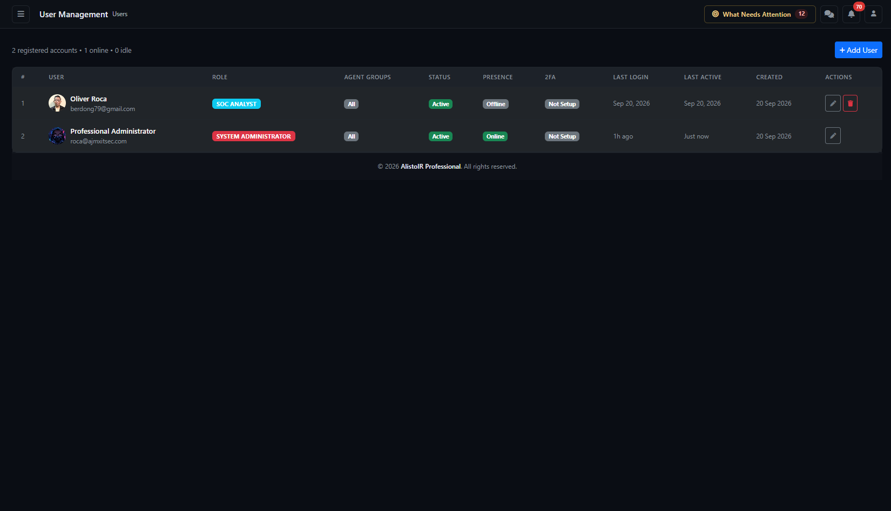

# User Management — administrator guide



Page: `/users/index`. Applies to AlistoIR Community 3.0.3. User management requires an authorized administrator account; ordinary SOC Analyst, SOC Manager and Viewer accounts should not assume access to this administration page.

Use this page to create accounts, edit identity/role/status, configure supported agent-group restrictions, change passwords, toggle existing two-factor authentication and delete accounts. It does not create endpoint/Wazuh agent accounts or configure the external AI provider.

<!-- toc:start -->

## Table of contents

- [Single-session sign-in in 3.0.4](#single-session-sign-in-in-304)
- [1. How to use it](#1-how-to-use-it)
- [2. Community account limit](#2-community-account-limit)
- [3. Header and account table](#3-header-and-account-table)
- [4. Roles](#4-roles)
- [5. Add User fields](#5-add-user-fields)
  - [Creation and credentials email](#creation-and-credentials-email)
- [6. Allowed Agent Groups](#6-allowed-agent-groups)
- [7. Edit an account and change a password](#7-edit-an-account-and-change-a-password)
- [8. Two-factor authentication](#8-two-factor-authentication)
- [9. Presence versus account status](#9-presence-versus-account-status)
- [10. Delete an account](#10-delete-an-account)
- [11. Troubleshooting](#11-troubleshooting)

<!-- toc:end -->

## Single-session sign-in in 3.0.4

Each account can have one active authenticated browser session. A second browser/device is denied until the original session logs out or expires; the first session is preserved. Closing the browser alone does not log out. Idle and absolute limits follow deployment settings. Use separate accounts for separate people.

## 1. How to use it

1. Sign in with an authorized System Administrator account and open **Users**.
2. Check active-account capacity and review the existing list before creating another identity.
3. Select **Add User**, fill in identity, role, status, allowed groups and initial password, then **Create User**.
4. Confirm the success/warning message and the new row. A credentials-email failure does not necessarily mean account creation failed.
5. Have the user sign in, complete the required first-login password change and configure their authenticator through the supported account-security workflow.
6. Verify the user's actual page/data access with the intended role and group scope.

Use a distinct account for each person so ownership and audit records remain attributable. Roles, group restrictions, account status, presence and 2FA are separate controls.

## 2. Community account limit

Community supports **five active accounts across the installation, including administrators**. Inactive accounts do not consume this active-account capacity. The counter can therefore differ from the number of registered rows displayed.

- At five active accounts, **Add User is disabled**, with a limit message.
- Edit an existing account and set Status to Inactive to free a slot, then refresh the list.
- Reactivating an inactive account requires an available slot.
- The server checks capacity when creating/reactivating accounts; a stale browser or a concurrent administrator's change can produce an account-limit message/dialog even if a button was previously available.
- Editing an already active account does not require a sixth slot.

An inactive account can be created without consuming capacity through a supported create submission when the form is accessible, but the Add User button is disabled whenever active capacity is full. Do not assume the UI provides a separate unlimited inactive-account creation path at that point.

Do not edit database limits or protected code to bypass capacity. Additional evaluation/deployment restrictions, if displayed, are separate from the Community five-active-account rule.

## 3. Header and account table

The header shows registered accounts in the accessible list, plus Online and Idle counts. Users are listed newest-created first; the current page has no built-in search/filter, CSV export or pagination controls.

| Column | Meaning |
|---|---|
| # | Account record identifier; not a license slot number. |
| User | Name, email and avatar/initials image. |
| Role | Effective account role label. |
| Agent Groups | Configured allowed-group labels, or All when no list is set. |
| Status | Active (green) or Inactive (gray). |
| Presence | Online, Idle or Offline, based on last recorded activity. |
| 2FA | Enabled, Disabled or Not Setup. |
| Last Login | Relative last recorded sign-in time, or Never. |
| Last Active | Relative last activity time, or Never. |
| Created | Account creation date. |
| Actions | Edit, eligible 2FA toggle, and Delete for another account. |

Names/emails can be sensitive. When no uploaded avatar exists, the current interface can request a generated image from an external avatar service using the user's name. This is separate from AI-provider sanitization. Use an uploaded avatar where that request is inappropriate for your deployment.

## 4. Roles

| Role | Intended responsibility |
|---|---|
| System Administrator | System/account administration and privileged configuration. Grant only to users who need that authority. |
| SOC Manager | Operational oversight and manager-permitted workflows. This is distinct from System Administrator. |
| SOC Analyst | Investigation and triage through analyst-permitted workflows. |
| Viewer / Auditor | Review through permitted viewing workflows. Do not assume every page or action is available. |

The role dropdown is not a complete permission matrix. Each route also applies its own authorization, account/organization scope and applicable feature checks. Assigning a role does not guarantee access to every module named in other guides.

System Administrator is a privileged platform context in this edition, not merely a cosmetic label. Avoid using it as a workaround for missing analyst data. Changes to another System Administrator are subject to administrator checks; the last active System Administrator cannot be demoted, disabled or deleted through these handlers. Self-deletion is prohibited.

## 5. Add User fields

| Field | How to complete it |
|---|---|
| Name | Person's display name. |
| Email | Valid, available account email; used for sign-in/notification. |
| Role | Choose the least privilege needed for the person's duties. |
| Status | Active for an enabled account; Inactive for an account that should not currently sign in. |
| Allowed Agent Groups | Optional Wazuh group-label values, comma-separated or one per line. Read the scope rules below. |
| Password / Confirm Password | Matching initial password that satisfies the policy displayed on the form. |
| Avatar | Optional JPG, PNG or GIF, at most 2 MB; square image recommended. |

The form derives password instructions from deployment configuration. The default minimum is 12 characters, with configured uppercase, lowercase, number and special-character requirements. Follow the displayed policy rather than assuming every deployment uses an identical length. The eye control changes password visibility locally; it does not generate or securely deliver a password.

Creation validates required fields, email, role, duplicate email, password policy and matching confirmation. Upload content/type and size are checked; changing a file extension does not make an unsupported image acceptable.

### Creation and credentials email

After creation, the application attempts to email account details, including the temporary password when supplied, using configured SMTP. Treat that message and the initial password as sensitive. Use a trusted delivery process and avoid shared/reused passwords.

If the page says the account was created but email could not be sent, **check the list before retrying**. The account can already exist; resolve SMTP delivery or coordinate a supported password change instead of generating duplicate accounts. A successful send result does not guarantee the recipient received or read the message.

New-account creation sets up the required first-login password-change behavior. Do not assume the same behavior or an automatic notification occurs whenever an administrator edits an existing password.

## 6. Allowed Agent Groups

This field controls supported Wazuh-record visibility using the **`agent.labels.group` value in ingested alert payloads**. It is not an endpoint deployment tool and does not add agents to Wazuh groups.

Example configuration for a training account:

```text
training-windows
training-linux
```

Use group values actually present in your forwarded records. Values can be separated by commas or newlines; normalization trims entries, removes duplicates and changes embedded whitespace to hyphens. Group matching is normalized for case, but do not rely on wildcard-shaped labels as security boundaries.

**Blank means unrestricted by this group list**, within other applicable access rules. It does not mean no access. When restricting an account, verify representative allowed and disallowed alerts; missing/mismatched labels can hide records from restricted users.

The current access helper treats SOC Manager and administrator contexts as unrestricted by agent-group lists. Giving such an account group labels is therefore not a guarantee of restricted visibility. Use the appropriate analyst/viewer role when group-limited review is required, and verify actual access.

Group restrictions apply through the application's supported scoping paths; they are not a guarantee of isolation for every arbitrary field, exported file, chat message or externally shared attachment. Role/organization checks remain relevant. See [Alerts](ALERTS.md) and [Alert View](ALERT_VIEW.md).

## 7. Edit an account and change a password

1. Select the account's **Edit** action.
2. Check the displayed name/email to ensure you are editing the intended person.
3. Change the required identity, role, status, agent groups or avatar.
4. Leave **New Password** blank to keep the current password. Enter a policy-compliant password only when you intend to replace it.
5. Select **Save Changes**, read the outcome and verify the resulting row/access.

The edit dialog does not display the existing password or provide a second confirmation-password field. A replacement password is validated and hashed; supported password-reset tokens are invalidated. This is not a separate “send reset email” action, nor proof that every existing session has been immediately revoked.

Setting Status to Inactive is the reversible account-disable workflow and frees active capacity after a successful save. It does not reassign the user's existing workload. Review alerts, cases, tasks and team responsibilities separately when someone leaves. Presence may temporarily still reflect the previous activity timestamp.

Changing your own role/status can affect your access. Maintain another authorized active administrator before making changes that could remove your administration privileges; the last-active-administrator protection is not a substitute for an access-recovery process.

## 8. Two-factor authentication

| 2FA state | Meaning |
|---|---|
| Not Setup | No authenticator secret is stored. An administrator cannot enable usable 2FA from this page until enrollment exists. |
| Disabled | A secret exists but the enabled flag is off. |
| Enabled | The configured authenticator is required by the applicable login workflow. |

To toggle an enrolled account, select its **Enable 2FA** or **Disable 2FA** action, verify the user in the confirmation modal and confirm. Users without a secret do not receive the same toggle buttons.

Enabling here does not create an authenticator enrollment, issue a new QR code or prove the user possesses the configured authenticator. Coordinate with the account holder first. Disabling retains the secret and can be reversed with Enable; it is not a secret rotation or recovery-code reset.

Only a System Administrator can change another System Administrator's 2FA through this handler. A successful toggle is security-logged. Do not disable 2FA simply to work around an unidentified login problem; confirm identity and use the supported recovery process.

## 9. Presence versus account status

Presence is calculated from the latest recorded activity when the page is loaded:

- **Online — green:** activity within approximately two minutes.
- **Idle — yellow:** more than two minutes and up to approximately 10 minutes.
- **Offline — gray:** older/missing/invalid activity timestamp.

This is not an endpoint health check, guaranteed open browser session, shift-attendance record or proof that someone read an alert. Active/Inactive controls account eligibility; Online/Idle/Offline estimates recent activity. Refresh to update this snapshot.

## 10. Delete an account

Select another user's **Delete** action, review the **Confirm Delete** modal and confirm only when permanent removal is intended. This is a database deletion, not the reversible Inactive status.

The handler explicitly clears assigned cases in the relevant scope and removes the user's agent-group association records before deleting the account. Do not assume it reassigns every alert, task, playbook or message relationship, or erases every historical reference. Review workload and attribution before removal; prefer disabling when you need to preserve an account identity.

You cannot delete yourself. Another System Administrator requires administrator authority, and the last active System Administrator is protected. If deletion fails, inspect the returned message before retrying; database relationships can prevent completion.

## 11. Troubleshooting

| Symptom | What to check |
|---|---|
| Add User disabled | Community's five-active-account capacity, including administrators. Disable an eligible existing account to free a slot. |
| Limit message on reactivation | Another account used the available slot; the server checks the latest active count. |
| Registered count exceeds five | Inactive accounts remain registered but do not consume active capacity. |
| Email already registered | Check existing/inactive accounts and the intended organization scope; edit the correct account rather than duplicating it. |
| Created but no email | The account may already exist. Check SMTP and message delivery separately. |
| User sees no Wazuh alerts | Role/access, allowed labels, forwarding payload and actual `agent.labels.group` values. |
| Manager sees more than listed groups | Manager/admin contexts bypass group-list restriction in the current access helper. |
| Cannot enable 2FA | Secret enrollment must exist; also check authority over the target account. |
| Disabled account still looks Online | Presence comes from recent activity; it is separate from eligibility and session-revocation guarantees. |
| Password update rejected | Follow the configured password policy; confirm that you intended to replace the password. |
| Avatar rejected | Actual JPG/PNG/GIF content, size at most 2 MB and upload/server settings. |
| Cannot remove/demote administrator | Self-deletion, target-admin authority and last-active-administrator protections. |
| Security validation failed | Refresh the signed-in page and retry; do not disable CSRF or integrity checks. |
| Empty list/load error | Check authorization, database/schema and server logs; an error is not evidence that all accounts were removed. |

Related guides: [Configuration](../docs/CONFIGURATION.md), [Alerts](ALERTS.md), [Analyst Chat](CHAT.md), [Direct Messages](DIRECT_MESSAGES.md), [Reports](REPORTS.md) and [Troubleshooting](../docs/TROUBLESHOOTING.md).
