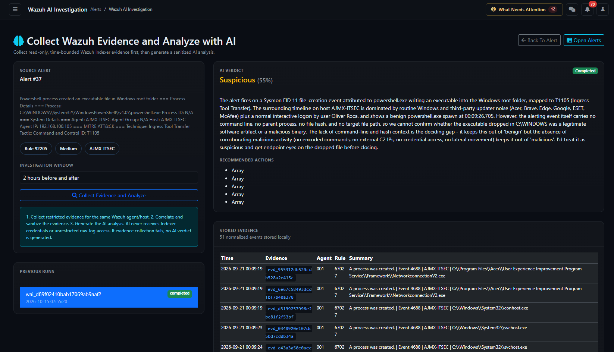

# Collect Wazuh Evidence and Analyze with AI — analyst guide

Page: `/alerts/wazuh_ai_investigate` with an existing alert reference. Applies to AlistoIR Community 3.0.3. Open **Collect Wazuh Evidence and Analyze with AI** from [Alert View](ALERT_VIEW.md), or open an existing Wazuh AI report linked to the investigation.

## What does this page do?

This workflow **collects read-only, time-bounded evidence from the configured Wazuh Indexer, stores normalized evidence locally, then requests a sanitized AI assessment**. It provides traceability through evidence references and a deterministic query audit.

| Workspace | Difference |
|---|---|
| [Investigate Logs](INVESTIGATE_LOGS.md) | Correlates alerts already ingested into AlistoIR; it does not directly collect Indexer evidence or run AI. |
| This Wazuh AI investigation | Queries the Indexer, stores evidence and generates a report from a bounded model input. |
| Endpoint Investigation | Collects supported live endpoint context through an endpoint collector. |
| [Investigation Center](INVESTIGATION_CENTER.md) | Tracks the larger autonomous workflow, evidence readiness and human review. |

This report is not a containment action, an analyst disposition or case closure. It can contribute evidence to the broader alert/case AI context without replacing those workflows.

## 1. Prerequisites and access

You need an accessible **Wazuh-origin alert** and working integrations:

- A resolvable Wazuh manager with the appropriate Indexer URL and credentials.
- Network routing, trusted TLS certificates and Indexer search permissions.
- Relevant retained records in the alerts index.
- A configured, available AI provider with required model permissions and balance/quotas.
- Enough original alert context to build a restricted endpoint/time query.

The page accepts the alert's AlistoIR reference (`alert_ref`) or internal Alert ID (`id`), not a Wazuh Rule ID. Authentication and row-access checks still apply. Non-Wazuh alerts are redirected with an eligibility message.

A working Manager API connection does not prove Indexer readiness. An enabled AI integration does not prove that its provider is reachable or has credits.

## 2. Source Alert panel and navigation

| Item | Meaning |
|---|---|
| Alert number and description | The record anchoring collection. |
| Rule / severity / endpoint chips | Original detection and endpoint context. Verify them before starting. |
| Back To Alert | Returns to the original alert. |
| Open Alerts | Opens the general alert list. |
| Investigation Window | Selects the time radius before and after the reference event. |
| Collect Evidence and Analyze | Starts a new collection/report request. |

Opening the page displays available previous runs. **Viewing a previous report does not automatically rerun collection.** Submitting the form can create another run and consume Indexer/provider resources; avoid repeated submissions while a request is processing.

## 3. Investigation Window

The reference time is derived primarily from the original event payload: Windows system time or available payload timestamps, then stored event time, then received time as a fallback. Invalid/unavailable time can limit the reliability of the chosen scope; automatic reporting requires valid original event context.

| Selection | Range around the reference time | Total span |
|---|---|---|
| 15 minutes before and after | ±15 minutes | 30 minutes |
| 30 minutes before and after | ±30 minutes | One hour |
| 1 hour before and after | ±1 hour | Two hours |
| 2 hours before and after | ±2 hours | Four hours |
| 4 hours before and after | ±4 hours | Eight hours |

The manual form defaults to **2 hours before and after**. An administrator's configured maximum can constrain effective scope. A larger window can return more context, but result limits still apply and it does not guarantee more complete evidence.

This differs from Investigate Logs, which primarily centers on received time. Delayed forwarding can therefore produce different results across the two pages even when a similar window is selected.

## 4. Collection scope and deterministic tools

The server builds the queries from the alert's endpoint, manager, time and available pivots. The AI does not receive Indexer credentials or unrestricted query access. This page is not an arbitrary query editor.

Endpoint constraints include available agent/host identifiers and manager context. Conflicting or incomplete identifiers can narrow results or prevent a reliable investigation; do not assume the system searched every host when an endpoint field is missing.

| Query tool | Evidence sought |
|---|---|
| `agent_timeline` | Available events for the endpoint/time scope. |
| `process_activity` | Process/PID/parent/command-line/file context derived from the source alert. |
| `network_activity` | Network indicators such as source/destination addresses, domains and URLs. |
| `authentication_activity` | Authentication-group events and supported login/privilege event IDs, with user context where available. |
| `file_activity` | File path and available MD5/SHA1/SHA256 context. |
| `rule_activity` | Detection rule, group, MITRE and event-ID context. |

Available pivots are combined into restricted queries, so a focused query can be empty even when the broad timeline contains records. The tool name describes the query intent, not proof that a behavior occurred.

**This workflow searches `wazuh-alerts-*`.** It does not prove coverage of every original endpoint log, archive or raw event. The Indexer helper's archive capability/configuration does not mean this report automatically searches `wazuh-archives-*`. Missing alerts cannot be treated as proof of no activity.

## 5. Collection and model limits

The workflow queries selected source fields and normalizes relevant event context rather than giving the model unrestricted raw-log access. Results can overlap across tools and evidence is deduplicated locally.

| Limit | Default / behavior |
|---|---|
| Events per query | Manual default 50, configurable within a bounded maximum of 100. |
| Evidence supplied to the model | Manual default up to 200 normalized events, bounded by configuration. |
| Automatic workflow budgets | Can be tighter: up to 25 events per tool and up to 100 model evidence events under this path. |
| Stored Evidence table on this page | Displays up to 150 evidence records, ordered by event time. The displayed count is not necessarily the total stored collection. |
| Previous Runs list | Shows the latest 10 runs for the alert. |
| Recommended Actions | The summary page displays up to six actions. |

Queries return events in ascending indexed timestamp order within their cap. A busy window can therefore omit later events. Model evidence is also bounded across the tool sequence, so records stored locally or returned by later tools are not guaranteed to be included in the model's input.

Do not add tool result counts to claim a unique-event total: the same event can be returned by several queries. Compare evidence references and the record limits instead.

## 6. Previous Runs

Each entry shows a report reference, status and creation time. Select a run to view its stored result, evidence and audit. These references identify Wazuh AI reports, not the separate `INV-...` autonomous run or a case.

The page defaults to the latest available run if no valid listed run is selected. Confirm the highlighted reference/time before comparing results or sharing a conclusion. An older report does not automatically incorporate evidence that arrived later.

## 7. Run status and color coding

| Status | Color | Interpretation |
|---|---|---|
| Running / Queued | Cyan/info | Collection or processing state; not a completed assessment. |
| Completed / Success | Green | The run or query operation finished successfully at that level. It does not mean the event is benign. |
| Failed | Red | Collection or report generation failed. Read the recorded error. |
| Cancelled / Skipped | Gray | The recorded task/run was cancelled or skipped where applicable. |
| Unknown / other | Gray | Unrecognized or unavailable classification. |

The run status and each query's status are distinct. A completed report can be based on partial successful collection and still have an Inconclusive verdict.

For a failed run, the page can show an Inconclusive/default verdict heading alongside the error. Treat the **failure message as authoritative about execution**; that placeholder is not proof that a model produced a valid assessment.

## 8. AI Verdict and Recommended Actions

| Verdict | Color | Meaning |
|---|---|---|
| Malicious | Red | The model recommends a malicious interpretation of the available evidence. Verify cited records and context. |
| Suspicious | Yellow/warning | Evidence warrants further investigation. |
| Benign | Green | A benign interpretation was returned; verify authorization and evidence completeness before disposition. |
| Inconclusive / other | Muted/gray | Evidence or the assessment does not support a defensible final conclusion. |

The percentage is a **model confidence estimate**, not measured accuracy or the probability an attack succeeded. Read the summary and suggested actions against the evidence, audit results and collection limits.

Recommended Actions are suggestions. They do not isolate endpoints, block addresses, create/close cases or record the analyst's final disposition.

### Failed, partial and empty collection

- If all queries fail, or a fatal connection/authentication/TLS failure prevents collection, the workflow fails without generating a new AI verdict.
- If some queries succeed and others fail, a report can be generated from successful evidence with limitations.
- A successful search returning zero events can still lead to a report explaining insufficient evidence. Zero results do not establish benign behavior.
- Zero events, failed queries or truncated results can cause an otherwise Benign model output to be constrained to Inconclusive.
- Provider/privacy/serialization failures can fail the report even after evidence was stored. Stored evidence remains separate from successful AI generation.

**Completed does not mean complete telemetry, clean endpoint, reviewed alert or resolved case.** The analyst's final decision remains separate.

## 9. Stored Evidence

| Column | Meaning |
|---|---|
| Time | Indexed/normalized event timestamp. |
| Evidence | Local evidence reference used to trace supporting events. |
| Agent | Recorded agent identifier. |
| Rule | Detection rule identifier where present. |
| Summary | Normalized event description; not the entire original Wazuh record. |

Normalized fields can include process/user/network/file and detection context. The table is a bounded local view; its wording about stored events reflects the displayed set, not necessarily every record in storage or every event in the Indexer.

A report reference and an evidence reference have different purposes. Preserve both when documenting a conclusion. If necessary details are absent, return to the original alert or perform an authorized search in Wazuh; do not infer missing values.

## 10. Deterministic Query Audit

Expand a tool entry to inspect:

- Tool name and status.
- Recorded result count.
- Available sanitized error text.
- Generated query JSON, with its time/endpoint constraints.
- **Copy Query JSON** to copy that query for authorized review.

The query is read-only and server-generated. The AI does not control the Indexer connection or arbitrary search scope. A successful query means the search operation succeeded, not that it found malicious activity or covered every relevant record.

**Copy Query JSON** only copies text; it does not run another search. Copied queries are JSON search requests, different from the query-bar text copied by Investigate Logs. Verify index, field mappings, time scope, permissions and limits before using them in an authorized query console.

The audit query can still contain real endpoint identifiers, network values or other investigation context. Error sanitization and the outbound-AI gate do not make every local audit field safe for public sharing.

## 11. Privacy and data flow

1. AlistoIR authenticates to the Indexer using its configured integration credentials.
2. Bounded results are normalized and stored locally with evidence references.
3. The model receives a bounded evidence projection through AIService's privacy sanitizer.
4. The report and query audit remain associated with the source alert.

Indexer credentials are not supplied to the model. The model provider's own API credential remains necessary in its authentication header. Recognized secrets are withheld, recognized identities/network values can receive aliases, and identified opaque/raw-log/note fields can be withheld.

Local Stored Evidence and Query Audit views are not identical to the sanitized model input. Copying their contents does not invoke the AI sanitizer. Pattern-based minimization cannot identify every sensitive detail in arbitrary prose; read [AI privacy](../docs/AI_PRIVACY.md) before external-provider use with client evidence.

## 12. How it aligns with autonomous investigation

An eligible autonomous worker can create a Wazuh AI report under configured collection rules and tighter budgets. Opening the report page lets analysts inspect that evidence rather than assuming it needs to be collected again.

On successful completion, related alert/case AI caches are invalidated so later AI refreshes can use changed evidence. That is not the same as instantly regenerating every Copilot, changing the alert status or stopping SLA clocks. Inspect each panel's timestamp and the broader run's readiness.

A manual report submission has its own action path; do not use the autonomous enable/disable switch as a master prohibition of all manual AI or Indexer activity. See [Investigation Settings](INVESTIGATION_SETTINGS.md).

## 13. Suggested analyst workflow

1. Verify source alert, endpoint/manager, event time and account scope.
2. Check Previous Runs before collecting again.
3. Choose the smallest useful window and select **Collect Evidence and Analyze**.
4. Allow the request to finish; avoid duplicate submissions while processing.
5. Read run status and query failures before interpreting a verdict.
6. Inspect normalized evidence, query scope, sample caps and missing sources.
7. Validate the summary and recommended actions against original records.
8. Record the separate analyst review, alert rationale and case updates as appropriate.
9. Use the authorized response/approval workflow if containment is justified; confirm execution separately.

## 14. Troubleshooting

| Symptom | What to check |
|---|---|
| Alert not found | Open from a visible record; use AlistoIR Alert ID/reference, not Rule ID. |
| Wazuh-origin eligibility message | This page is restricted to Wazuh-origin alerts. |
| Indexer not configured | Administrator must check the manager's Indexer URL/user/password and effective configuration. |
| Connection refused / timeout / DNS error | Indexer service, address, routing, source access and timeout. |
| Authentication / permission error | Credentials and permission to search the relevant index. |
| TLS / certificate failure | Correct CA trust and hostname/IP match; do not disable TLS verification. |
| Empty evidence | Endpoint/manager identifiers, original time, indexed retention, field mappings and query pivots. |
| Some queries fail | Inspect each audit entry. Partial evidence cannot prove absence of the unobserved behavior. |
| Provider or quota failure | Provider credentials, model access, balance, limits and connectivity. Evidence may already be stored. |
| Privacy-blocked request | Review the reported input/serialization issue through supported administration; do not bypass the privacy gate. |
| Invalid security token | Refresh the signed-in page and submit the intended request again. |
| Counts differ across reports or tables | Compare run/window, per-query overlap, storage deduplication, model caps and the 150-row display limit. |
| Report says Completed but alert remains open | Expected: report completion is not analyst disposition or case closure. |

For clients, report the selected scope, evidence actually obtained, query/provider limitations, supported findings and the analyst's next action. Avoid presenting a green run status or confidence estimate as confirmation of incident resolution.

Continue with [Alert View](ALERT_VIEW.md), [Investigate Logs](INVESTIGATE_LOGS.md), [Investigation Center](INVESTIGATION_CENTER.md), [Wazuh setup](../docs/WAZUH_SETUP.md) and [Troubleshooting](../docs/TROUBLESHOOTING.md).
